# AIRWISE System Architecture Blueprint

**Project:** AIRWISE — AI-Enabled Dynamic Air Operations & Resource Optimisation  
**SIH Problem Statement:** SIH 26250 (Air Power: Dynamic Air Operations & Resource Optimisation)  
**Document Status:** Authoritative Technical Blueprint (Frozen for Implementation)  
**Architects:** Lakshay Bharti, Nakshatra Yadav, Nidhi Jha  

---

## 1. System Context & Operational Boundaries

### 1.1 Objective & Scope
**AIRWISE** is an open, modular, synthetic-data-driven decision-support prototype engineered to optimize multi-base air fleet resource scheduling, anticipate operational disruptions via calibrated predictive models, compute legally and physically feasible allocations using formal constraint programming (Google OR-Tools CP-SAT), explain binding constraints, and support counterfactual ("What-If") disruption replanning.

* **In-Scope Core Capabilities:**
  - Ingestion and auditing of open research benchmarks (TU Delft, NASA C-MAPSS, US BTS).
  - Procedural generation of deterministic synthetic operational scenarios with 100% referential integrity.
  - Canonical in-memory operational state management with immutable snapshotting and event replay.
  - Formal mathematical constraint programming (Google OR-Tools CP-SAT) with interval disjunctions.
  - Independent feasibility auditing module and transparent Greedy baseline heuristic.
  - Tabular predictive models (LightGBM / HistGradientBoosting) predicting maintenance failure risk and turnaround delays.
  - Prediction-to-optimization integration (dynamic buffer insertion and risk penalties).
  - Counterfactual What-If simulation sandbox and Plan Diff Analyzer.
  - Automated headless scientific benchmarking and statistical evaluation harness.
  - FastAPI REST service exposing typed endpoints for scenarios, state, optimization, and simulation.

* **Explicitly Excluded Scope:**
  - **Frontend UI Implementation:** The React/TypeScript dashboard, Tailwind styling, and Gantt charts are developed by separate teammates and are outside the implementation scope of the core three-person team.
  - **Classified or Real Tactical Data:** Under no circumstances does the system ingest classified, proprietary, or operational military records.
  - **Autonomous Real-World Execution:** The system provides decision support; it does not issue autonomous command-and-control actions or integrate with weapons systems.
  - **Unnecessary Deep Learning Bloat:** Reinforcement learning, Graph Neural Networks, and Transformers are excluded as tabular gradient boosted trees and formal constraint solvers provide superior performance, calibration, and interpretability for this domain.

---

## 2. Comprehensive Component Architecture (21 Logical Components)

AIRWISE is structured as a **Modular Monolith** organized into four functional tiers:

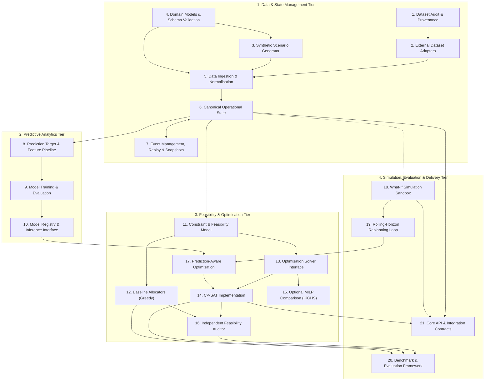

### Detailed Component Specifications

| ID | Component Name | Primary Owner | Module Location | Responsibility & Interfaces | Inputs & Outputs | Failure Modes & Error Handling |
| :--- | :--- | :--- | :--- | :--- | :--- | :--- |
| **C01** | **Dataset Audit & Provenance** | Nakshatra | `docs/data-audit.md` | Tracks licenses, DOIs, schemas, and security checklists for open datasets (4TU, NASA, BTS). | In: Web portals. Out: Audit catalog & security policy. | Corrupt links or changed licenses trigger re-audit. |
| **C02** | **External Dataset Adapters** | Nakshatra | `src/data/adapters.py` | Parses external formats (NASA C-MAPSS text files, BTS Parquet, TU Delft Excel). | In: External files. Out: Normalized raw tabular frames. | Non-matching schema triggers structured quarantine. |
| **C03** | **Synthetic Scenario Generator** | Nakshatra | `src/generator/scenario_generator.py` | Procedurally generates deterministic operational scenarios based on random seeds. | In: `GeneratorConfig`. Out: Initial `CanonicalOperationalState`. | Infeasible parameter inputs raise `ConfigurationError`. |
| **C04** | **Domain Models & Validation** | Nakshatra | `src/domain/models.py`, `schemas.py` | Enforces strong Pydantic v2 domain schemas, units, and mathematical invariants. | In: Raw dictionary records. Out: Validated domain objects. | Field constraint violations raise `ValidationError`. |
| **C05** | **Data Ingestion & Normalisation**| Nakshatra | `src/data/safe_loader.py` | Sanitizes input files, enforces size limits (<50MB), converts timestamps to integer minutes. | In: JSON/CSV files. Out: Clean normalized entity records. | File size or Zip-Slip violations abort ingestion safely. |
| **C06** | **Canonical Operational State** | Nakshatra | `src/state/canonical_state.py` | In-memory source of truth with $O(1)$ indexed entity lookups and deep-copy snapshots. | In: Domain entities. Out: State snapshot objects. | Missing entity lookups return structured `EntityNotFound`. |
| **C07** | **Event Management & Replay** | Nakshatra | `src/state/events.py`, `fusion_engine.py` | Ingests asynchronous operational events, sorts chronologically, and resolves state conflicts. | In: `OperationalEvent` stream. Out: Mutated state. | Duplicate event IDs treated as idempotent no-ops. |
| **C08** | **Prediction Target & Features** | Lakshay | `src/prediction/features.py` | Extracts feature matrices from canonical state with strict temporal cutoff guards ($t \le t_{\text{cut}}$). | In: State & event histories. Out: Feature matrix $X$. | Timestamp lookahead raises `TemporalLeakageError`. |
| **C09** | **Model Training & Evaluation** | Lakshay | `src/prediction/train.py` | Trains baseline and LightGBM models with chronological splits; calibrates probabilities. | In: Feature matrix $X, y$. Out: Model weights & Brier scores. | Overfitting or low AUC (<0.70) halts deployment. |
| **C10** | **Model Registry & Inference** | Lakshay | `src/prediction/service.py` | Serves pure-Python serialized model inferences for failure risk and turnaround delays (<20ms). | In: Current state. Out: `DisruptionRiskProfile`. | Missing features impute with historical median values. |
| **C11** | **Constraint & Feasibility Model** | Lakshay | `src/optimization/constraints.py` | Translates state into formal CP-SAT interval variables, cumulative bounds, and objective terms. | In: State & risk profile. Out: CP-SAT mathematical model. | Conflicting domain rules identified prior to solve. |
| **C12** | **Baseline Allocators (Greedy)** | Nidhi | `src/baselines/greedy_solver.py` | Deterministic Earliest-Deadline-First allocator providing non-vacuous benchmark. | In: State & config. Out: Baseline `OptimizationResult`. | Fully saturated fleets gracefully leave tasks unassigned. |
| **C13** | **Solver Interface Contracts** | Lakshay | `src/optimization/solver_interface.py`| Abstract interface decoupling solver algorithms from caller application logic. | In: State & `SolverConfig`. Out: `OptimizationResult`. | Interface invariant breaches raise `ContractViolation`. |
| **C14** | **CP-SAT Implementation** | Lakshay | `src/optimization/cp_sat_solver.py` | Google OR-Tools CP-SAT solver enforcing interval disjunctions and cumulative runway slots. | In: CP-SAT model. Out: Primal solution & status. | Search timeouts safely return best feasible solution. |
| **C15** | **Optional MILP Comparison** | Lakshay | `src/optimization/milp_solver.py` | Linearized big-M formulation using HiGHS for formal algorithmic benchmarking. | In: Linearized model. Out: MILP solution & runtime. | Numerical instability or timeout reported cleanly. |
| **C16** | **Independent Feasibility Auditor** | Nidhi | `src/evaluation/auditor.py` | Audits candidate plans against all hard constraints without using solver variables. | In: Candidate plan & state. Out: `AuditReport` (violations). | Any constraint violation triggers audit failure alert. |
| **C17** | **Prediction-Aware Optimisation** | Lakshay | `src/optimization/risk_aware_solver.py`| Injects dynamic turnaround buffers and failure penalties into the CP-SAT model. | In: State, risks, solver. Out: Risk-resilient schedule. | Negative buffers clamped to zero. |
| **C18** | **What-If Simulation Sandbox** | Nidhi | `src/simulation/sandbox.py` | Clones operational state into an isolated sandbox without mutating the baseline plan. | In: Active state snapshot. Out: Sandboxed state instance. | Memory isolation verified; 0 mutation to source. |
| **C19** | **Rolling-Horizon Replanning** | Nidhi | `src/simulation/what_if_engine.py` | Injects disruptions (`GroundAircraft`), updates risks, re-optimizes, and diffs schedules. | In: Sandbox & disruptions. Out: Re-optimized plan & diff. | Infeasible replans trigger constraint relaxation log. |
| **C20** | **Benchmark Framework** | Nidhi | `experiments/benchmark_runner.py` | Headless evaluation harness executing scale sweeps and generating Pareto curves. | In: Scenario matrices. Out: CSV/JSON metrics & charts. | Run crashes logged with seed for exact reproduction. |
| **C21** | **Core API & Handoff Contracts** | Nakshatra & Lakshay | `src/api/main.py`, `routes/*.py` | Asynchronous FastAPI service exposing REST endpoints and OpenAPI schema for frontend team. | In: HTTP requests. Out: Validated JSON responses. | Unhandled exceptions return RFC 7807 error format. |

---

## 3. Required Architectural Diagrams

### Diagram 1: System-Context Diagram
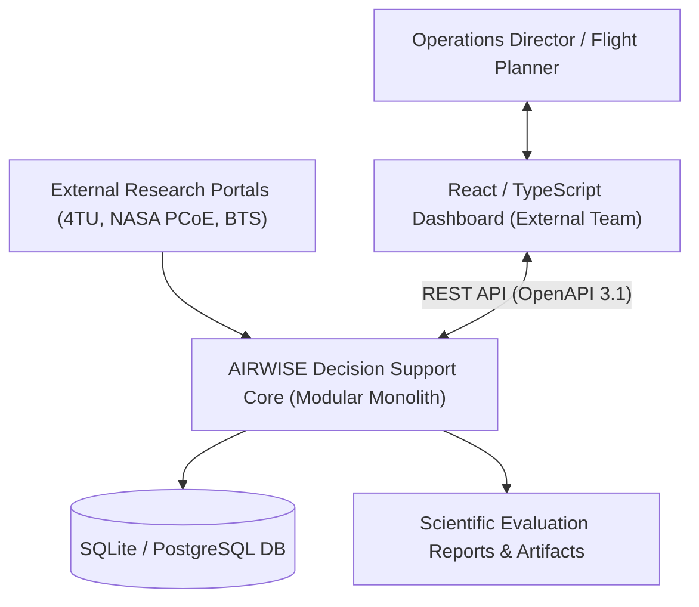

### Diagram 2: High-Level Component Diagram
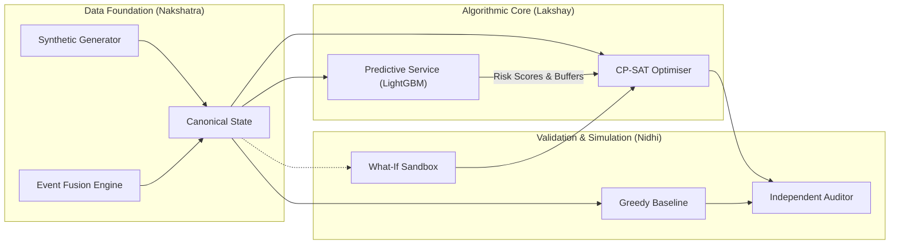

### Diagram 3: Data-Ingestion and Provenance Flow
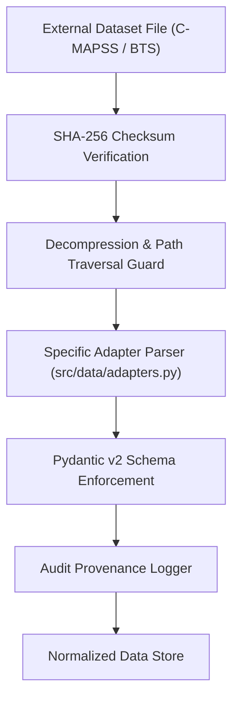

### Diagram 4: Synthetic Scenario Generation and Ground-Truth Flow
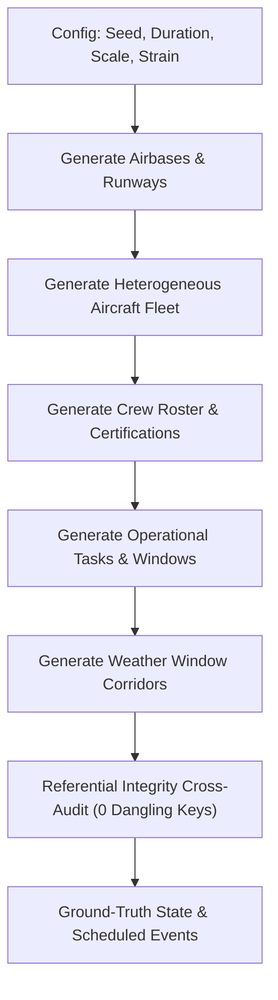

### Diagram 5: Canonical State and Event Lifecycle
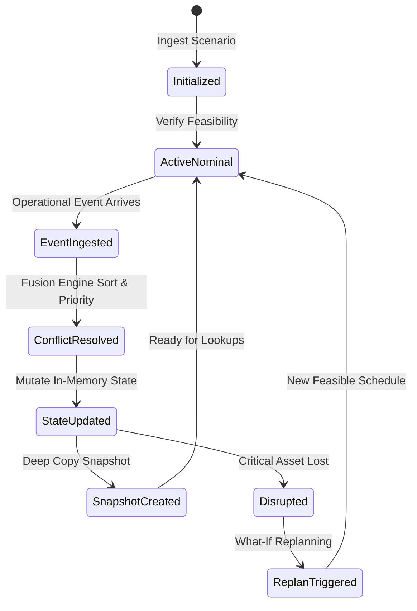

### Diagram 6: ML Training and Inference Pipeline

### Diagram 7: Optimisation and Independent Validation Pipeline
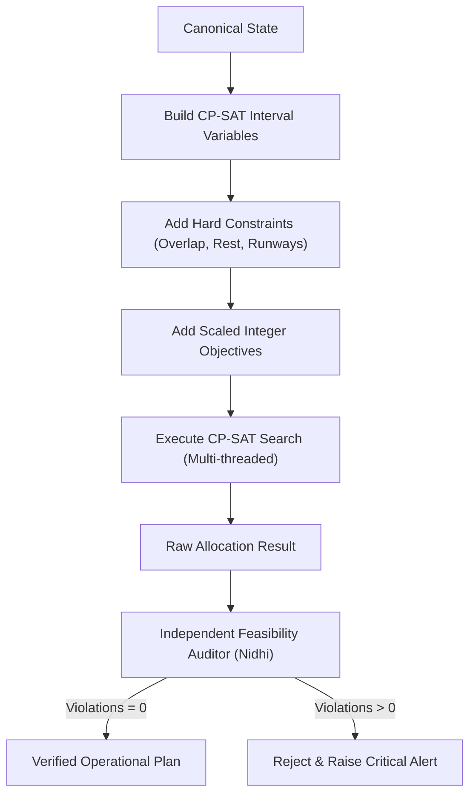

### Diagram 8: Prediction-to-Optimisation Interaction
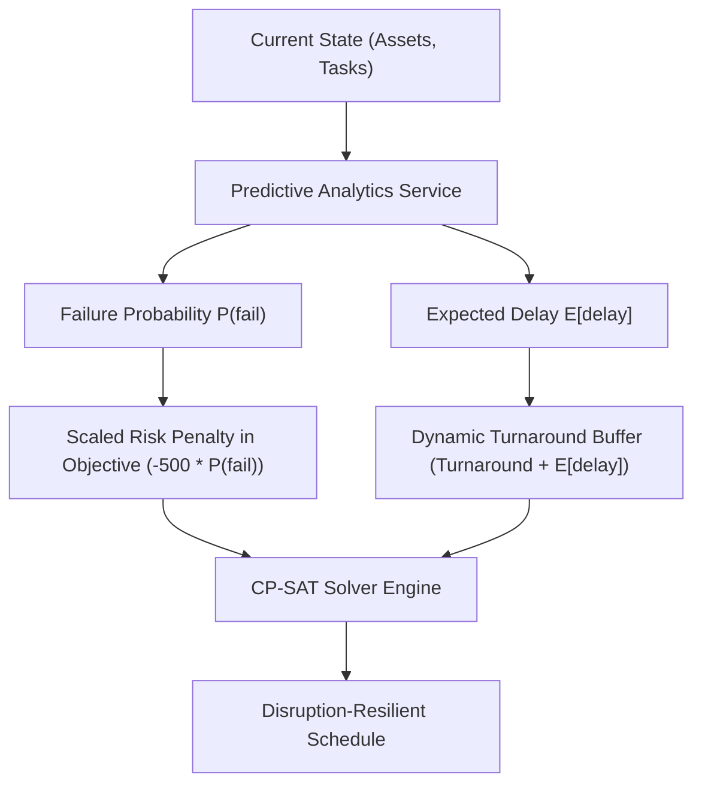

### Diagram 9: What-If Simulation and Replanning Sequence
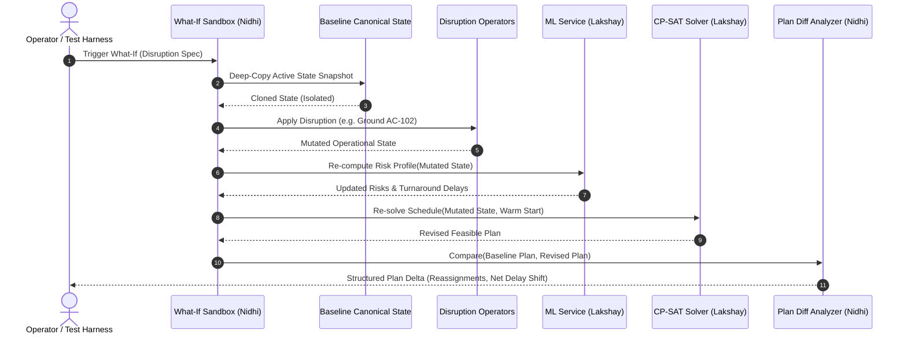

### Diagram 10: Experiment and Evaluation Flow
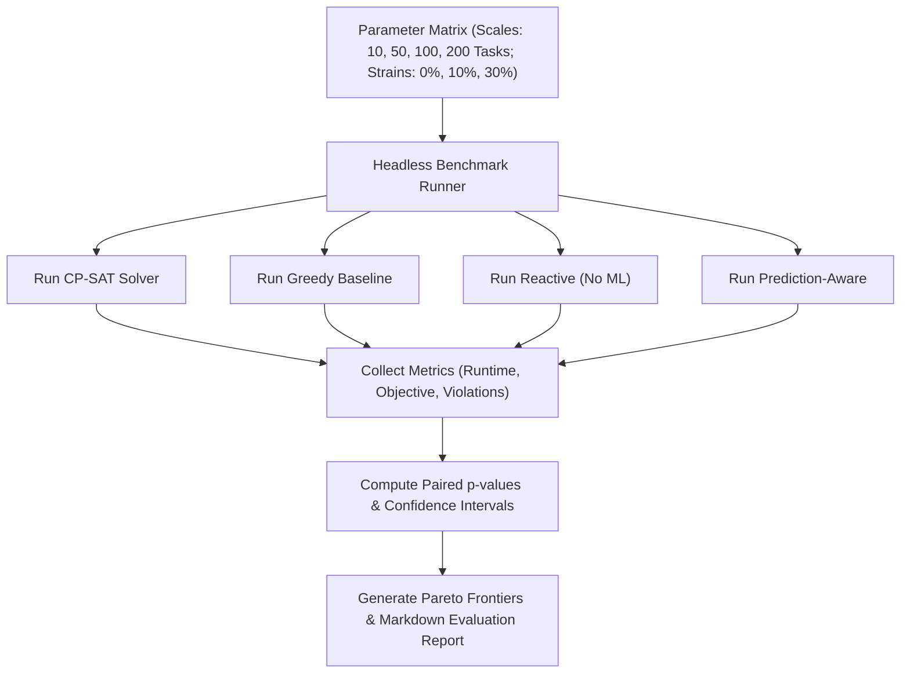

### Diagram 11: Three-Person Module-Ownership Diagram
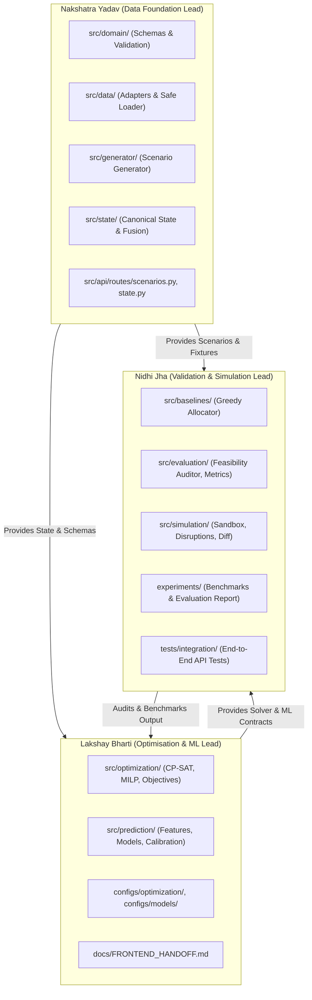

### Diagram 12: Git Branch and Integration Workflow
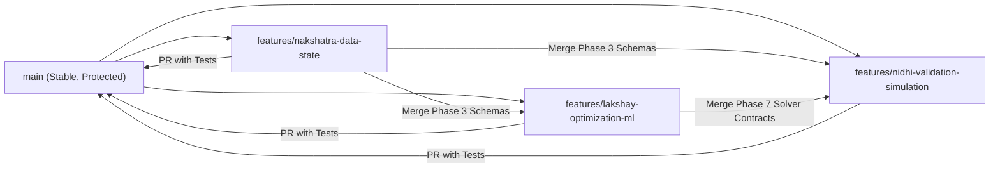

### Diagram 13: Phase Dependency Diagram
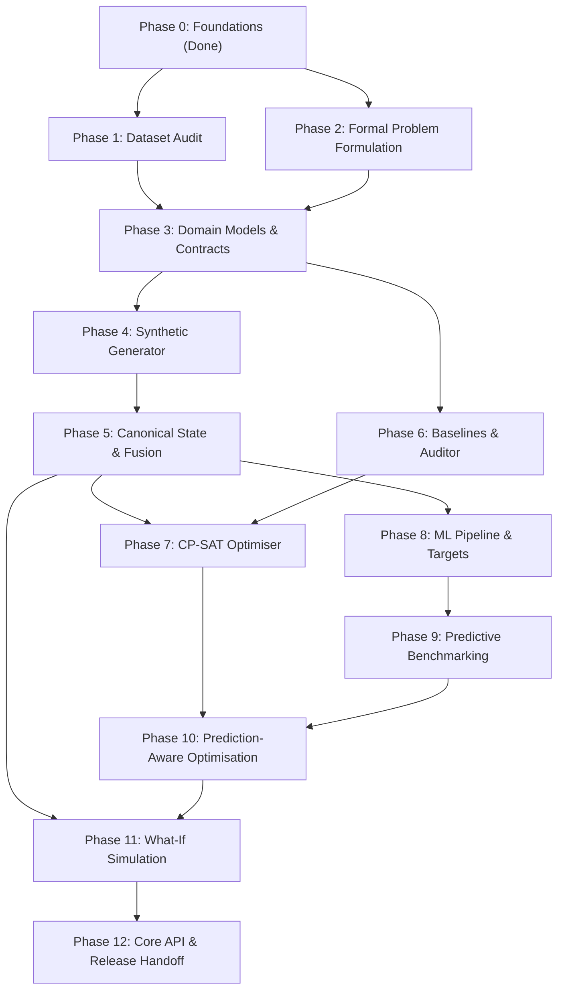

---

## 4. Mathematical Formulation & Solver Mechanics

*(Full mathematical specifications, parameters, and decision variables are detailed in [`docs/optimisation-design.md`](file:///C:/Users/Lakshay/OneDrive/Desktop/PROJECTS/AirOps-Optimizer/docs/optimisation-design.md)).*

### 4.1 Decision Variables
- $u_t \in \{0, 1\}$: Binary variable; $1$ if task $t \in \mathcal{T}$ is scheduled, $0$ if unassigned.
- $x_{t, a} \in \{0, 1\}$: Binary variable; $1$ if task $t$ is assigned to aircraft $a \in \mathcal{A}$.
- $y_{t, c} \in \{0, 1\}$: Binary variable; $1$ if task $t$ is assigned to crew member $c \in \mathcal{C}$.
- $s_t \in [EST_t, LST_t]$: Scheduled departure time in minutes from epoch.
- $e_t \in [EST_t + D_t, LST_t + D_t + \widehat{\Delta}_t]$: Scheduled completion time in minutes.
- $delay_t = \max(0, s_t - EST_t)$: Departure delay in minutes.

### 4.2 Hard Constraints
1. **Assignment Uniqueness:** $\sum_{a} x_{t, a} = u_t$ and $\sum_{c} y_{t, c} = u_t$.
2. **Capability Compatibility:** $x_{t, a} = 0$ if $cap_a \neq req\_type_t$.
3. **Qualification Matching:** $y_{t, c} = 0$ if $req\_qual_t \notin qual_c$.
4. **Interval Disjunction (No-Overlap):** Aircraft intervals $[s_t, e_t + Turnaround_a + \widehat{\Delta}_t]$ must not overlap for the same airframe (`model.AddNoOverlap`).
5. **Crew Flight Duty Limits:** $\sum_{t} D_t \cdot y_{t, c} \le MaxDuty_c$ within any rolling 24-hour window, with mandatory $MinRest_c$ between duties.
6. **Hourly Runway Capacity:** Movement counts per airbase per hour $\le MaxSlots_{b, h}$.
7. **Maintenance Bay Lockout:** Aircraft in scheduled maintenance cannot be assigned to flight sorties.

### 4.3 Scaled Integer CP-SAT Objective
$$\max \quad \mathcal{J} = \sum_{t \in \mathcal{T}} 1000 \cdot p_t \cdot u_t - 10 \sum_{t \in \mathcal{T}} delay_t - \sum_{t, a} \left\lfloor \frac{500 \cdot \lfloor 10000 \cdot \widehat{P}^{\text{fail}}_a \rfloor}{10000} \right\rfloor \cdot x_{t, a} - 250 \sum_{t, a} ChurnVar_{t, a}$$

---

## 5. Architectural Assumptions & Status Register

| ID | Description | Rationale / Evidence | Impact if False | Owner | Status |
| :--- | :--- | :--- | :--- | :--- | :--- |
| **ASSUMP-001** | Integer minute discretization is sufficient for operational scheduling. | Real-world air operations plan flight legs and turnarounds in minute intervals. | High: Would require continuous seconds modeling. | Lakshay | **ACCEPTED** |
| **ASSUMP-002** | Airbase runway capacity can be modeled as hourly movement buckets. | Standard civil and military air traffic management uses hourly slot capacities. | Medium: Would require runway wake turbulence spacing. | Lakshay | **ACCEPTED** |
| **ASSUMP-003** | Pure synthetic operational data is required for the core integrated pipeline. | No open dataset provides joint aircraft-crew-task-runway military planning data. | Critical: Synthetic generator is mandatory. | Nakshatra | **ACCEPTED** |
| **ASSUMP-004** | Pure-Python ML model inference latency is under 20ms on CPU. | LightGBM and linear models evaluate small feature vectors in $< 5$ms. | Low: If slow, cache inference results. | Lakshay | **ACCEPTED** |
| **ASSUMP-005** | Memory cloning (`copy.deepcopy`) of canonical states runs in $< 5$ms for 500 entities. | Python dictionaries of Pydantic models clone in $< 3$ms in microbenchmarks. | Low: If slow, implement custom shallow-copy cloner. | Nidhi | **ACCEPTED** |
