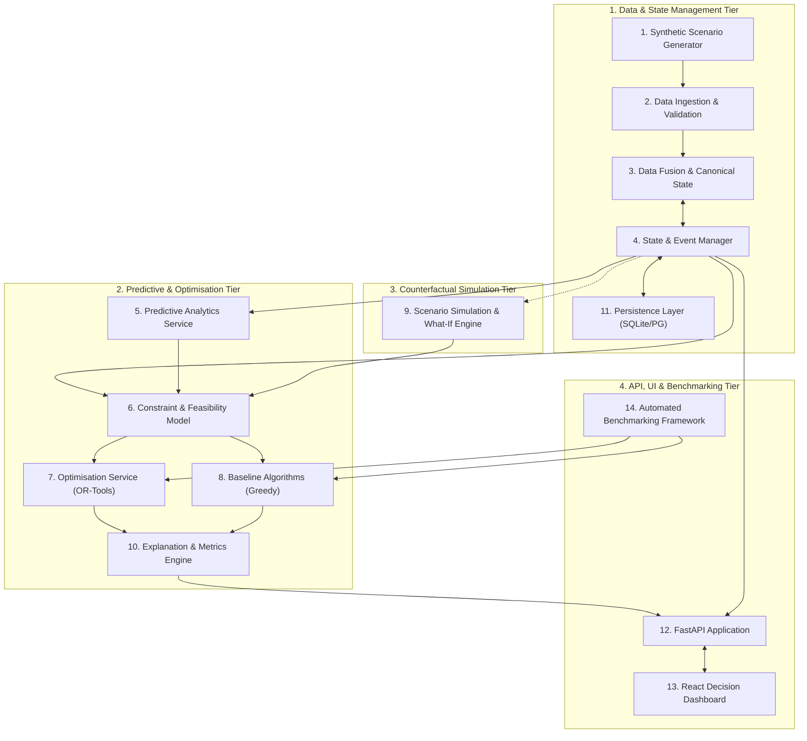
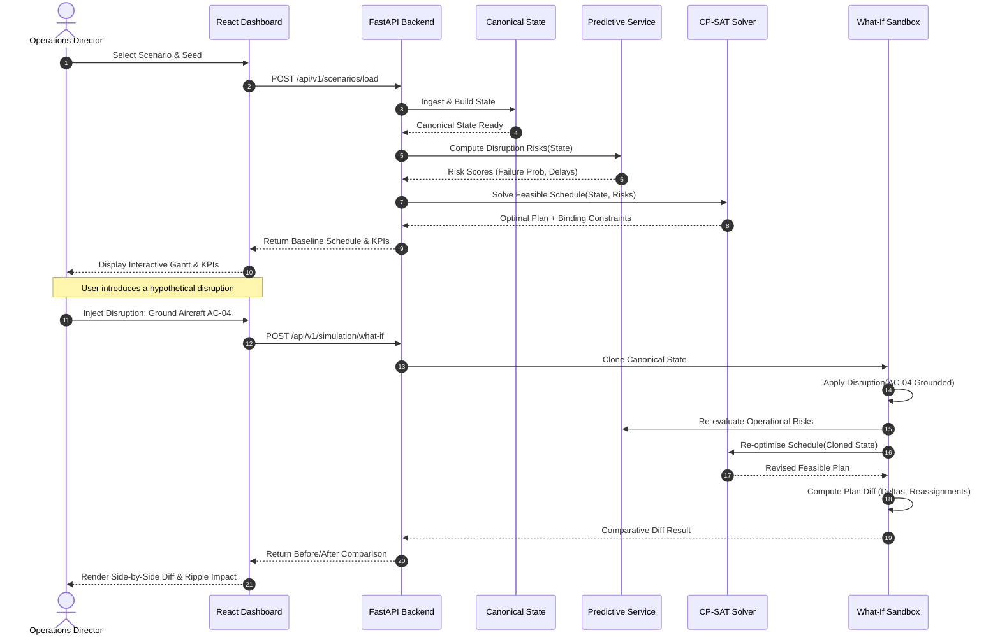

# AIRWISE System Architecture Blueprint

## 1. System Context & Overview

**AIRWISE (AI-Enabled Dynamic Air Operations & Resource Optimisation)** is an intelligent decision-support system designed to assist operational directors and planning officers in scheduling, allocating, and dynamically replanning aviation fleet resources under complex constraints and emergent disruptions.

The system fuses heterogeneous synthetic operational streams, applies calibrated predictive models to anticipate disruptions, executes formal constraint satisfaction and mathematical optimization algorithms to compute provably feasible schedules, explains trade-offs, and provides interactive counterfactual ("What-If") scenario exploration.

### Architectural Philosophy
1. **Modular Monolith First:** Domain logic is kept cohesive in well-defined internal modules rather than fragmented across distributed microservices. This avoids network latency, distributed transaction complexity, and deployment overhead while maintaining clean architectural boundaries.
2. **Explicit Separation of Concerns:**
   - **Prediction** estimates future operational state probabilities (e.g., equipment failure, turnaround delay).
   - **Optimization** computes the optimal allocation under hard physical/regulatory constraints based on those predictions.
3. **Deterministic Replayability:** Any operational state or what-if scenario can be reproduced bit-for-bit using explicit scenario seeds and event logs.

---

## 2. Logical Component Topology

The system comprises 14 primary logical components organized into four functional tiers:

### Detailed Component Responsibilities

#### 1. Synthetic Scenario Generator (`src/generator`)
- **Responsibility:** Procedurally synthesize internally consistent, referentially intact operational scenarios.
- **Inputs:** `ScenarioConfig` (random seed, duration, base count, aircraft count, mission density, disruption rate).
- **Outputs:** Serialized scenario data bundle (airbases, runways, airframe types, aircraft units, crew rosters, maintenance bays, scheduled tasks, weather patterns).
- **Isolation:** Standalone, deterministic module with zero external network or database dependencies.

#### 2. Data Ingestion & Validation (`src/domain`, `src/state/ingestion`)
- **Responsibility:** Ingest scenario bundles or simulated telemetry events, validating strictly against Pydantic v2 schemas.
- **Error Handling:** Rejects corrupt records with structured validation errors without halting system execution.

#### 3. Data Fusion & Canonical Operational State (`src/state/canonical_state.py`)
- **Responsibility:** Maintain the unified, in-memory, timestamped truth of all resources, locations, and tasks.
- **Mechanics:** Employs indexed lookups (`O(1)` access by asset ID) and maintains historical state checkpoints.

#### 4. State & Event Management (`src/state/events.py`)
- **Responsibility:** Process asynchronous state changes (e.g., sortie completed, maintenance alert triggered) via an immutable event envelope pattern.
- **Capabilities:** Resolves conflicting updates (e.g., telemetry vs. manual input) using explicit timestamp and priority rules.

#### 5. Predictive Analytics Service (`src/prediction`)
- **Responsibility:** Generate probabilistic estimates of impending operational bottlenecks.
  - Target 1: `P(Unscheduled Maintenance)` (Calibrated binary classification via LightGBM / Logistic Regression).
  - Target 2: `Expected Turnaround Delay (minutes)` (Continuous regression via Gradient Boosting).
- **Contract:** Exposes pure Python inference functions taking asset histories and returning bounded probabilities `[0.0, 1.0]` and delay intervals.

#### 6. Constraint & Feasibility Model (`src/optimization/constraints.py`)
- **Responsibility:** Translate the operational state and predictive risks into formal mathematical constraints and objective formulations.
- **Constraint Catalog:**
  - *Hard Constraints:* No overlapping aircraft assignments, crew duty-hour limits, aircraft capability matching, runway hourly capacity limits, mandatory maintenance intervals.
  - *Soft Objectives:* Weighted task completion value, total delay penalty, crew overtime penalty, schedule disruption penalty.

#### 7. Optimisation Service (`src/optimization/cp_sat_solver.py`)
- **Responsibility:** Solve the constraint satisfaction and combinatorial optimization problem using Google OR-Tools CP-SAT.
- **Features:** Supports deterministic search limits (timeout, worker threads), extracts primal solutions, and reports optimality gaps.

#### 8. Baseline Algorithms (`src/optimization/greedy_solver.py`)
- **Responsibility:** Provide transparent, deterministic heuristics (e.g., Earliest-Deadline-First greedy allocator) to serve as a strict, non-vacuous benchmark against the CP-SAT solver.

#### 9. Scenario Simulation & What-If Engine (`src/simulation`)
- **Responsibility:** Support counterfactual experimentation. Clones the canonical state, applies user-defined hypothetical disruptions (e.g., runway closed, aircraft grounded), and triggers re-optimization.
- **Guarantee:** Strict isolation; never mutates the primary active operational plan.

#### 10. Explanation & Metric Calculation (`src/optimization/explainer.py`, `src/optimization/metrics.py`)
- **Responsibility:** Generate human-interpretable rationales for computed allocations.
  - Identifies binding constraints causing tasks to be delayed or unassigned.
  - Calculates operational KPIs: fleet readiness, task fulfillment rate, asset utilization percentages.

#### 11. Persistence Layer (`src/db`)
- **Responsibility:** Manage persistent storage of scenarios, historical plans, event logs, and comparative evaluation runs using SQLAlchemy 2.0.
- **Portability:** Defaults to local SQLite file database; supports zero-code switch to PostgreSQL via connection string configuration.

#### 12. FastAPI Application (`src/api`)
- **Responsibility:** Expose asynchronous REST endpoints adhering to OpenAPI specifications, enforcing request validation and CORS policies.

#### 13. React Decision-Support Dashboard (`frontend/`)
- **Responsibility:** Render an interactive, low-latency operator interface featuring interactive Gantt timelines, fleet health tables, predictive risk badges, and side-by-side plan comparisons.

#### 14. Automated Benchmarking Framework (`experiments/`)
- **Responsibility:** Execute headless, parameter-swept experimental evaluations comparing algorithm performance across scales and disruption severities.

---

## 3. Data Flow & Execution Sequence

The following sequence diagram illustrates the lifecycle of an operational workflow: from scenario loading and predictive inference, through initial optimization, followed by a human-initiated what-if disruption and re-optimization.

---

## 4. Mathematical Formulation Overview

### Decision Variables
Let:
- $T$ be the set of operational tasks (sorties, transports, patrols).
- $A$ be the set of available aircraft.
- $C$ be the set of crew members.
- $x_{t, a} \in \{0, 1\}$: Binary variable indicating if task $t$ is assigned to aircraft $a$.
- $y_{t, c} \in \{0, 1\}$: Binary variable indicating if task $t$ is assigned to crew member $c$.
- $s_t \ge 0$: Integer/Continuous variable representing the start time of task $t$.
- $u_t \in \{0, 1\}$: Binary variable indicating whether task $t$ was fulfilled ($1$) or unassigned ($0$).

### Hard Constraints
1. **At most one assignment per task:**
   $$\sum_{a \in A} x_{t, a} = u_t \quad \forall t \in T$$
2. **Aircraft Capability Compatibility:**
   $$x_{t, a} = 0 \quad \text{if airframe } a \text{ lacks capability for task } t$$
3. **Crew Qualification Compatibility:**
   $$y_{t, c} = 0 \quad \text{if crew } c \text{ lacks certification for task } t$$
4. **No Temporal Overlap (Aircraft):**
   If $x_{t1, a} = 1$ and $x_{t2, a} = 1$ ($t1 \neq t2$), then:
   $$s_{t2} \ge s_{t1} + \text{Duration}(t1) + \text{Turnaround}(a) \quad \lor \quad s_{t1} \ge s_{t2} + \text{Duration}(t2) + \text{Turnaround}(a)$$
   *(Formulated in CP-SAT using `model.AddNoOverlap` on interval variables).*
5. **Crew Maximum Duty Hours:**
   $$\sum_{t \in T} \text{Duration}(t) \cdot y_{t, c} \le \text{MaxDutyHours}(c) \quad \forall c \in C$$

### Soft Objective Function
Maximize the composite operational utility:
$$Z = \sum_{t \in T} \Big[ w_t^{\text{priority}} \cdot u_t - w^{\text{delay}} \cdot \max(0, s_t - \text{ScheduledStart}_t) \Big] - \sum_{t \in T} \sum_{a \in A} P(a \text{ failure}) \cdot x_{t, a}$$
Where:
- $w_t^{\text{priority}}$ is the task priority weight.
- $w^{\text{delay}}$ is the penalty per minute of schedule slippage.
- $P(a \text{ failure})$ is the predictive risk provided by the ML service, penalizing high-risk airframe assignments on critical sorties.

---

## 5. Persistence Strategy

- **Local Development & Demonstrations:** Default zero-configuration SQLite embedded database (`airops.sqlite3`).
- **Production / Multi-user Migration:** Seamless compatibility with PostgreSQL via standard SQLAlchemy connection URI.
- **Data Lifecycle:**
  - Scenarios and event histories are persisted with explicit run IDs.
  - Solver allocations and comparative diff records are stored as JSON blobs with foreign key linkages to parent scenarios.

---

## 6. Security, Isolation & Safety

1. **Non-Tactical Synthetic Boundary:** All domain models model generic aircraft logistics (fuel capacity, speed, payload weight, maintenance hours). No tactical weapons envelopes or classified command systems are included.
2. **Local Execution Context:** By default, the application runs entirely locally on `localhost:8000` and `localhost:5173`. No external cloud telemetry or third-party tracking is present.
3. **Secret Management:** Strict `.gitignore` enforcement for `.env`. No hardcoded credentials.

---

## 7. Key Architectural Trade-Offs

| Decision | Selected Approach | Alternative Considered | Justification |
| :--- | :--- | :--- | :--- |
| **Monolith vs Microservices** | Modular Monolith | Microservices (FastAPI + Celery + RabbitMQ) | Avoids network overhead, serialization costs, and infrastructure complexity for a decision-support prototype. |
| **Optimization Technology** | OR-Tools CP-SAT | Mixed-Integer Linear Programming (CBC/Gurobi) | CP-SAT has native, highly-optimized interval scheduling variables (`AddNoOverlap`) ideal for fleet scheduling. |
| **Predictive Modeling** | LightGBM / Ridge | Deep Sequence Models (LSTM / Transformers) | Tabular operational data is best modeled by calibrated gradient boosted trees with lower latency and higher interpretability. |
| **State Storage** | In-Memory Canonical State with SQLite Backup | Direct Database Queries for Everything | Enables ultra-fast what-if branching, cloning, and re-optimization in sub-millisecond memory operations. |
