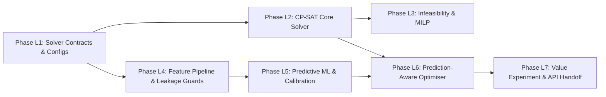

# Lakshay Bharti: Detailed Operational Implementation Phases
## Optimisation Engine, Mathematical Modeling & Predictive Analytics Core

**Lead:** Lakshay Bharti (Senior OR Engineer & ML Architect)  
**Dedicated Branch:** `features/lakshay-optimization-ml`  
**Reference Document:** `Lakshay.md`, `ARCHITECTURE.md`, `docs/optimisation-design.md`, `docs/prediction-design.md`  

---

## Overview of Implementation Sub-Phases

---

## Phase L1: Optimization Interface Contracts & Solver Configuration Foundation
* **Sub-Phase ID:** `LAKSHAY-P1`
* **Purpose:** Establish abstract solver interface contracts, data transfer objects, solver status enumerations, and configuration loaders to decouple optimization algorithms from callers.
* **Exact Tasks:**
  1. Define `SolverStatus` enum (`OPTIMAL`, `FEASIBLE`, `INFEASIBLE`, `MODEL_INVALID`, `UNKNOWN`).
  2. Implement `TaskAssignment` and `OptimizationResult` dataclasses in `src/optimization/solver_interface.py`.
  3. Implement `SolverConfig` dataclass and YAML loader supporting timeouts, workers, scaling factors, and objective weights.
  4. Create `configs/optimization/solver_config.yaml` with default parameters.
  5. Package `src/optimization/__init__.py` exposing clean public interfaces.
  6. Author unit tests `tests/unit/test_solver_interface.py` verifying dataclass immutability, serialization, and configuration parsing.
* **Deliverables:** `src/optimization/solver_interface.py`, `src/optimization/solver_config.py`, `configs/optimization/solver_config.yaml`, unit test suite.
* **Acceptance Criteria:**
  - 100% test pass on `test_solver_interface.py`.
  - Zero dependencies on external database or solver binaries in interface definitions.
* **Exclusions:** CP-SAT solver implementation.

---

## Phase L2: Core CP-SAT Solver Implementation & Constraint Modeling
* **Sub-Phase ID:** `LAKSHAY-P2`
* **Purpose:** Implement the primary constraint programming solver using Google OR-Tools CP-SAT, formulating interval disjunctions, crew duty limits, and runway slot movements.
* **Exact Tasks:**
  1. Implement `CPSatOptimizationSolver` in `src/optimization/cp_sat_solver.py`.
  2. Implement hard constraint builders in `src/optimization/constraints.py`:
     - Assignment uniqueness ($\sum_a x_{t,a} = u_t$, $\sum_c y_{t,c} = u_t$).
     - Aircraft capability matching and crew certification filters.
     - Aircraft non-overlapping disjunctions via `model.AddNoOverlap` on interval variables.
     - Crew maximum duty hours (rolling 24h) and mandatory rest.
     - Airbase hourly runway movement slot limits.
  3. Implement integer objective scaling in `src/optimization/objectives.py` ($K_{\text{scale}} = 10,000$).
  4. Implement search timeout enforcement and primal solution extraction.
  5. Author unit tests `tests/unit/test_optimization_solver.py` and `tests/unit/test_solver_timeout.py`.
* **Deliverables:** `src/optimization/cp_sat_solver.py`, `src/optimization/constraints.py`, `src/optimization/objectives.py`, test suite.
* **Acceptance Criteria:**
  - Zero hard constraint violations on feasible test scenarios.
  - Terminates cleanly at `time_limit_seconds ± 0.5s` returning best primal solution.

---

## Phase L3: Infeasibility Diagnosis, Slack Relaxation & Optional MILP Solver
* **Sub-Phase ID:** `LAKSHAY-P3`
* **Purpose:** Provide automated infeasibility diagnosis for over-constrained scenarios and implement a comparative MILP solver using HiGHS.
* **Exact Tasks:**
  1. Implement constraint relaxation diagnostic routine identifying unsat cores (crew shortages, runway bottlenecks).
  2. Implement comparative linearized MILP model in `src/optimization/milp_solver.py` using SciPy / HiGHS.
  3. Author comparative unit tests benchmarked against known mathematical bounds.
* **Deliverables:** `src/optimization/milp_solver.py`, diagnostic reporting in `OptimizationResult`.
* **Acceptance Criteria:** Over-constrained scenarios diagnosed with human-readable bottleneck reports.

---

## Phase L4: Predictive Analytics Feature Pipeline & Leakage Guards
* **Sub-Phase ID:** `LAKSHAY-P4`
* **Purpose:** Implement feature extraction from state histories with strict temporal cutoff guards, preventing future data leakage.
* **Exact Tasks:**
  1. Build feature extraction module `src/prediction/features.py` (accumulated flight hours, cycles, weather severity, base congestion).
  2. Implement chronological train/test split generator in `src/prediction/train.py`.
  3. Implement synthetic ground-truth labeling functions for maintenance failures and turnaround delays.
  4. Author automated leakage guard unit tests `tests/unit/test_leakage_guard.py`.
* **Deliverables:** `src/prediction/features.py`, `src/prediction/train.py`, automated leakage test suite.
* **Acceptance Criteria:** Unit tests assert zero future timestamp observations ($t > t_{\text{cut}}$) in feature matrices.

---

## Phase L5: Predictive Modeling, Probability Calibration & Lightweight Inference Service
* **Sub-Phase ID:** `LAKSHAY-P5`
* **Purpose:** Train and calibrate LightGBM models for failure risk classification and turnaround delay regression, exporting pure-Python inference artifacts.
* **Exact Tasks:**
  1. Implement baseline models (Logistic Regression, Ridge) and LightGBM models in `src/prediction/models.py`.
  2. Implement Platt scaling / Isotonic regression probability calibration.
  3. Export model artifacts to `models/checkpoints/`.
  4. Implement `PredictiveAnalyticsService` in `src/prediction/service.py` meeting $< 20$ms CPU latency.
  5. Author unit tests `tests/unit/test_prediction_service.py`.
* **Deliverables:** Trained model artifacts, inference service, calibration metrics report.
* **Acceptance Criteria:** ROC-AUC $\ge 0.75$, Brier score $\le 0.15$, CPU inference $< 20$ms for 100 assets.

---

## Phase L6: Prediction-Aware Optimization Solver
* **Sub-Phase ID:** `LAKSHAY-P6`
* **Purpose:** Connect calibrated failure probabilities and turnaround delay estimates directly into the solver's objective weights and interval durations.
* **Exact Tasks:**
  1. Implement `RiskAwareOptimizationSolver` in `src/optimization/risk_aware_solver.py`.
  2. Integrate failure risk penalties into the CP-SAT objective function.
  3. Invert turnaround delay predictions into dynamic safety buffers ($Turnaround + \widehat{\Delta}_t$).
  4. Author integration tests verifying risk-penalized aircraft selection.
* **Deliverables:** `src/optimization/risk_aware_solver.py`, integration test suite.
* **Acceptance Criteria:** Solver shifts critical sorties away from high-risk airframes while preserving hard feasibility.

---

## Phase L7: Downstream Decision Value Verification & Frontend Handoff Contracts
* **Sub-Phase ID:** `LAKSHAY-P7`
* **Purpose:** Experimentally verify downstream decision improvements (mission abort reduction) and package frozen API contracts for the frontend team.
* **Exact Tasks:**
  1. Execute comparative benchmark: Reactive (No ML) vs. Prediction-Aware scheduling across 50 test scenarios.
  2. Document statistical findings in `experiments/reports/prediction_value.md`.
  3. Export OpenAPI schema and author `docs/FRONTEND_HANDOFF.md` with typed TypeScript definitions.
* **Deliverables:** `docs/FRONTEND_HANDOFF.md`, downstream value experimental report.
* **Acceptance Criteria:** Statistically significant reduction in mission aborts ($\ge 30\%$) and delays ($\ge 20\%$).
