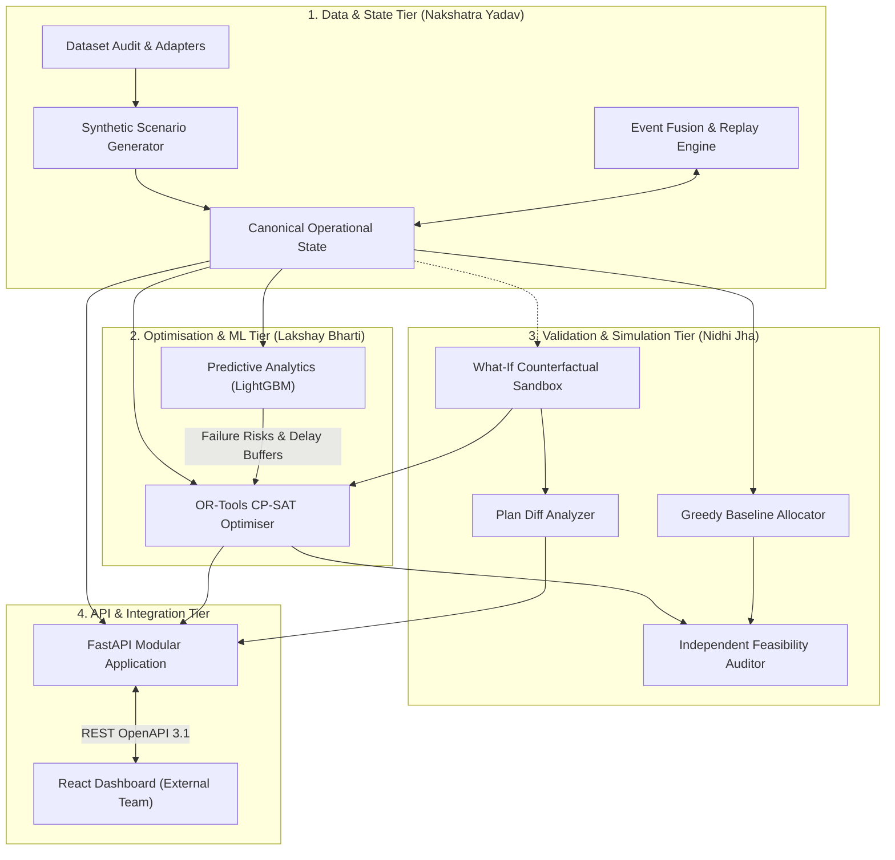
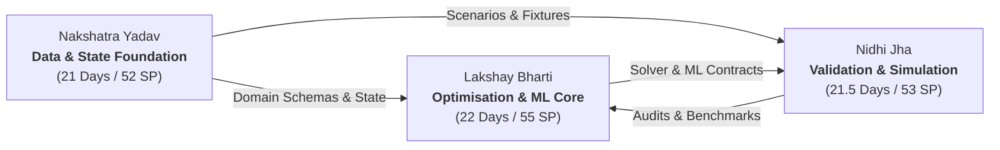

# AIRWISE: AI-Enabled Dynamic Air Operations & Resource Optimisation

> **Repository:** [https://github.com/DAREDEVIL-OF-NEXUS/AirOps-Optimizer](https://github.com/DAREDEVIL-OF-NEXUS/AirOps-Optimizer)  
> **System Identifier:** `AIRWISE` (`airops-optimizer`)  
> **SIH Problem Title:** Air Power — Dynamic Air Operations & Resource Optimisation  

---

## 1. Executive Summary & Problem Statement

Planning and dynamically adjusting complex resource allocations in aviation fleet operations is inherently difficult. Information regarding **aircraft readiness, airframe fatigue, flight crew certifications, duty-hour limits, maintenance bay availability, runway movement slots, and weather corridors** is frequently fragmented across disconnected systems.

When unexpected disruptions occur—such as sudden mechanical degradation, localized severe weather fronts, runway closures, or urgent sortie priority escalations—human planners face extreme cognitive overload under severe time constraints. Manual heuristic scheduling often leads to cascaded flight delays, under-utilized maintenance slots, crew duty-hour breaches, or cancelled high-priority sorties.

### The Proposed Solution
**AIRWISE** is an open, modular decision-support prototype engineered to:
1. **Fuse & Validate** multi-source operational data into a strongly-typed, canonical in-memory state container.
2. **Predict Future Disruptions** (unscheduled maintenance failure risk, flight turnaround delays) using calibrated tabular machine learning models (LightGBM).
3. **Optimise Multi-Resource Allocations** using formal constraint programming (Google OR-Tools CP-SAT) with interval disjunctions and cumulative movement limits, rigorously benchmarked against an independent Greedy baseline.
4. **Independently Audit Feasibility**, mathematically verifying that zero hard physical or regulatory constraints are violated.
5. **Facilitate Interactive "What-If" Counterfactual Simulation**, allowing operators to inject hypothetical disruptions into isolated sandboxes, dynamically replan, and inspect comparative deltas before committing operational orders.

---

## 2. Core Engineering Principles

* **Separation of Prediction and Optimisation:** Machine learning estimates *probabilities and delays*. The formal constraint solver determines *provably feasible allocations* maximizing utility subject to inviolable constraints. Predictive models are never used as a substitute for constraint solvers.
* **Inviolable Hard Constraints vs. Soft Preferences:**
  * *Hard Constraints (Inviolable):* Non-overlapping aircraft sorties (`AddNoOverlap`), crew mandatory rest intervals, certification matching, and hourly runway throughput limits.
  * *Soft Objectives (Trade-offs):* Maximizing high-priority sortie fulfillment, minimizing schedule delays, minimizing crew overtime, and penalizing plan churn.
* **Deterministic Synthetic Operational Data (Option B Hybrid Strategy):** Operational schedules are synthesized procedurally with 100% referential integrity and seed-based reproducibility. External open datasets (NASA C-MAPSS, US BTS) are used strictly as offline ML benchmarks.
* **Human-Centred Decision Support:** The software advises, explains, and diffs contingency plans; it does not autonomously execute real-world operations or integrate with tactical weapons systems.

---

## 3. High-Level System Architecture

AIRWISE is implemented as a **Modular Monolith** organized into four functional tiers across 21 logical components:

For complete technical specifications, mathematical formulations, and diagrams, see [ARCHITECTURE.md](ARCHITECTURE.md).

---

## 4. Three-Person Workstream Ownership Model

The core engineering workload outside the frontend is partitioned into three mutually exclusive, collectively exhaustive workstreams:

* **[Lakshay.md](Lakshay.md) — Lakshay Bharti (Optimisation & ML Lead):**
  - Owns mathematical formulations, Google OR-Tools CP-SAT solver, optional MILP comparison, predictive modeling pipeline (LightGBM), probability calibration, and prediction-aware optimization.
  - Directories: `src/optimization/`, `src/prediction/`, `configs/optimization/`, `configs/models/`.
  - Feature Branch: `features/lakshay-optimization-ml`.

* **[Nakshatra.md](Nakshatra.md) — Nakshatra Yadav (Data Foundation Lead):**
  - Owns external dataset auditing, data security threat modeling, Pydantic v2 domain schemas, procedural synthetic scenario generator, and in-memory canonical state fusion engine.
  - Directories: `src/domain/`, `src/data/`, `src/generator/`, `src/state/`, `data/scenarios/`.
  - Feature Branch: `features/nakshatra-data-state`.

* **[Nidhi.md](Nidhi.md) — Nidhi Jha (Validation & Simulation Lead):**
  - Owns independent feasibility auditing, transparent Greedy baseline solver, counterfactual What-If sandbox, disruption mutation operators, Plan Diff Analyzer, and scientific benchmarking harness.
  - Directories: `src/baselines/`, `src/evaluation/`, `src/simulation/`, `experiments/`, `tests/integration/`.
  - Feature Branch: `features/nidhi-validation-simulation`.

*The frontend is handled by external teammates and is outside the implementation scope of these three workstreams.*

---

## 5. Master Implementation Roadmap (Phases 0 to 12)

The project is structured into 13 sequential implementation phases:

* **Phase 0 — Repository Foundations & Planning Revision:** **VERIFIED COMPLETE**
* **Phase 1 — Dataset Discovery, Audit, and Selection:** Planned (`features/nakshatra-data-state`).
* **Phase 2 — Formal Problem Definition & Mathematical Formulation:** Planned (`features/lakshay-optimization-ml`).
* **Phase 3 — Canonical Domain Model & Data Contracts:** Planned (`features/nakshatra-data-state`).
* **Phase 4 — Synthetic Scenario & Event Generation:** Planned (`features/nakshatra-data-state`).
* **Phase 5 — State Management, Ingestion, Fusion, and Replay:** Planned (`features/nakshatra-data-state`).
* **Phase 6 — Independent Feasibility Checker & Baseline Allocators:** Planned (`features/nidhi-validation-simulation`).
* **Phase 7 — Constraint-Programming Optimiser & Solver Validation:** Planned (`features/lakshay-optimization-ml`).
* **Phase 8 — Prediction Target Design & Reproducible Training Pipeline:** Planned (`features/lakshay-optimization-ml`).
* **Phase 9 — Predictive-Model Benchmarking & Selection:** Planned (`features/lakshay-optimization-ml`).
* **Phase 10 — Prediction-Aware Rolling-Horizon Optimisation:** Planned (Lakshay & Nidhi).
* **Phase 11 — What-If Simulation, Robustness, & Integrated Evaluation:** Planned (`features/nidhi-validation-simulation`).
* **Phase 12 — Core API Contracts, Reproducible Release, & Frontend Handoff:** Planned (All Leads).

Detailed task breakdowns are maintained in [PHASES.md](PHASES.md) and live task audit logs in [COMPLETION.md](COMPLETION.md).

---

## 6. Comprehensive Documentation Index

All architectural blueprints, design documents, and governance files are version-controlled within the repository:

* [ARCHITECTURE.md](ARCHITECTURE.md) — Authoritative technical blueprint with 21 components, 13 Mermaid diagrams, and mathematical formulations.
* [ROADMAP.md](ROADMAP.md) — Milestone specifications (M0 through M12) and risk registers.
* [PHASES.md](PHASES.md) — Step-by-step operational phase specifications with acceptance criteria and quality gates.
* [COMPLETION.md](COMPLETION.md) — Living master task audit register tracking task statuses.
* [REQUIREMENTS.md](REQUIREMENTS.md) — Functional (`FR-001`–`FR-015`) and non-functional (`NFR-001`–`NFR-008`) specifications.
* [DECISIONS.md](DECISIONS.md) — Architectural decision records (ADR-001 through ADR-012).
* [CONTRIBUTING.md](CONTRIBUTING.md) — Workstream rules, branching hygiene, code standards, and security protocols.
* [docs/data-audit.md](docs/data-audit.md) — Formal audit of candidates A–H, security threat model, and Option B hybrid decision.
* [docs/optimisation-design.md](docs/optimisation-design.md) — Detailed CP-SAT interval scheduling formulation, integer scaling, and baselines.
* [docs/prediction-design.md](docs/prediction-design.md) — Machine learning targets, temporal splits, calibration, and value experiment.
* [docs/data-model.md](docs/data-model.md) — Pydantic domain models, physical units, timestamps, and event envelopes.
* [docs/testing-strategy.md](docs/testing-strategy.md) — Test pyramid, domain verification specifications, and quality gates.
* [docs/workstream-ownership.md](docs/workstream-ownership.md) — Master task-to-owner matrix, effort estimates, and integration sequence.
* [Lakshay.md](Lakshay.md) — Individual workstream ownership specification for Lakshay Bharti.
* [Nakshatra.md](Nakshatra.md) — Individual workstream ownership specification for Nakshatra Yadav.
* [Nidhi.md](Nidhi.md) — Individual workstream ownership specification for Nidhi Jha.

---

## 7. Synthetic Data & Operational Security Disclaimer

> [!IMPORTANT]
> **Synthetic Operational Data Notice:**  
> AIRWISE is developed entirely using generated synthetic datasets, idealized airspace models, and generic civil/operational logistical parameters. It **does not** contain, ingest, or depend upon classified, confidential, proprietary, or actual military operational data. No combat tactics, weapon delivery envelopes, or military command-and-control integrations are implemented.
