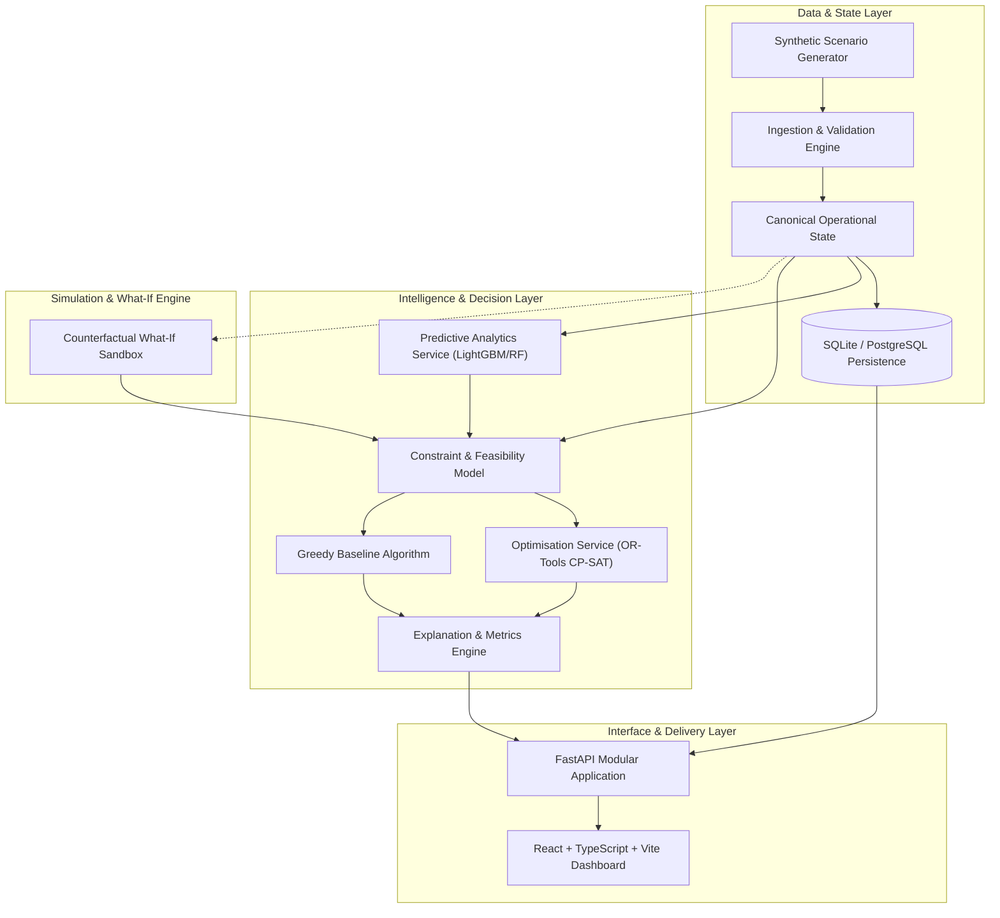

# AIRWISE: AI-Enabled Dynamic Air Operations & Resource Optimisation

[](COMPLETION.md)
[](LICENSE)
[](https://github.com/DAREDEVIL-OF-NEXUS/AirOps-Optimizer)
[](ARCHITECTURE.md)

> **Repository:** [https://github.com/DAREDEVIL-OF-NEXUS/AirOps-Optimizer](https://github.com/DAREDEVIL-OF-NEXUS/AirOps-Optimizer)  
> **System Identifier:** `AIRWISE` (`airops-optimizer`)

---

## 1. Executive Summary & Problem Statement

Planning and dynamically adjusting complex resource allocations in aviation and fleet operations is inherently difficult. Information regarding **aircraft availability, crew qualifications, duty-time limits, maintenance bay capacity, fuel logistics, environmental weather windows, and shifting operational priorities** is frequently fragmented across siloed systems. 

When unexpected disruptions occur—such as sudden component degradation, adverse weather fronts, runway maintenance closures, or urgent sortie priority adjustments—human planners face high cognitive loads under severe time constraints. Standard heuristic manual scheduling often leads to cascaded flight delays, under-utilised maintenance windows, crew duty-hour violations, or sub-optimal mission completion.

### The Proposed Solution
**AIRWISE** is an open, modular decision-support prototype engineered to:
1. **Fuse and Validate** multi-source operational data into a coherent, canonical state model.
2. **Predict Future Operational Bottlenecks** (equipment failure probability, weather disruption risk, turnaround delays) using calibrated predictive analytics.
3. **Optimise Resource Allocation** using a formal mathematical constraint programming engine (Google OR-Tools CP-SAT) paired with a transparent greedy baseline.
4. **Explain Recommendations**, detailing which constraints are binding, which trade-offs were negotiated, and why an allocation was chosen.
5. **Facilitate Interactive "What-If" Counterfactual Simulation**, enabling operations directors to inject disruptions, re-optimise, and inspect comparative deltas before committing operational plans.

---

## 2. Core Engineering Principles

* **Separation of Prediction and Optimisation:** Machine learning estimates *what is likely to happen* (probabilities of delay, maintenance failure risks, weather transitions). The mathematical optimisation solver determines *what actions to take* by maximising utility subject to hard physical and legal constraints. Predictive models are never used as a substitute for constraint solvers.
* **Rigorous Distinction Between Hard Constraints and Soft Objectives:**
  * *Hard Constraints (Inviolable Feasibility):* Crew rest regulations, aircraft payload limits, qualification matchings, non-overlapping runway schedules, and maintenance bay capacity limits.
  * *Soft Objectives (Preference Trade-offs):* Minimising delay minutes, maximising high-priority mission fulfillment, minimising crew deadhead transfers, and reducing operational friction.
* **Deterministic, Coherent Synthetic Data:** Realistic operational schedules generated via seedable, time-aware generative models with referential integrity. No random, unlinked tables.
* **Human-Centred Decision Support:** The software advises and explains; it does not trigger autonomous real-world actions. All outputs are neutral, non-tactical, and non-classified.
* **Reproducibility & Transparent Benchmarking:** Formal metrics, seed logging, exact parameter auditing, and baselines (CP-SAT vs. Greedy vs. Unoptimised) without unsubstantiated claims.

---

## 3. Synthetic Data & Safety Disclaimer

> [!IMPORTANT]
> **Synthetic Operational Data Notice:**  
> AIRWISE is developed entirely using generated synthetic datasets, idealized airspace models, and generic civil/operational logistical parameters. It **does not** contain, ingest, or depend upon classified, confidential, proprietary, or actual military operational data. No operational combat tactics, weapon delivery envelopes, or military command-and-control integrations are implemented.

---

## 4. System Architecture & Component Topology

AIRWISE is structured as a **Modular Monolith**, ensuring low deployment overhead, strict domain boundaries, and high computational efficiency.



For complete technical specifications, mathematical formulations, and data flow sequences, see [ARCHITECTURE.md](ARCHITECTURE.md).

---

## 5. Technology Stack

| Domain | Technology / Library | Rationale |
| :--- | :--- | :--- |
| **Backend Framework** | Python 3.11+, FastAPI, Uvicorn | High performance, asynchronous I/O, native OpenAPI docs, strict typing. |
| **Data Validation** | Pydantic v2 | High-throughput schema validation and data integrity enforcement. |
| **Persistence** | SQLAlchemy 2.0, SQLite / PostgreSQL | Robust ORM with schema migrations; SQLite for local runs, PostgreSQL for production. |
| **Optimisation Solver** | Google OR-Tools (CP-SAT) | State-of-the-art constraint programming solver for scheduling and assignment. |
| **Optimisation Baseline**| Custom Deterministic Greedy Allocator | Transparent, non-vacuous comparative baseline for benchmarks. |
| **Machine Learning** | scikit-learn, LightGBM | Calibrated probabilistic classification and regression without unnecessary deep-learning bloat. |
| **Data Manipulation** | NumPy, pandas | Vectorized time-series and schedule transformation. |
| **Frontend UI** | React 18, TypeScript, Vite | Fast, typed, reactive component hierarchy for high-density operational data. |
| **Styling & Icons** | Tailwind CSS, Lucide React | Modern, responsive, clean enterprise operations design system. |
| **Data Visualisation** | Recharts, Plotly.js | Interactive Gantt schedules, resource utilisation bars, and Pareto trade-off curves. |
| **Quality & Testing** | pytest, pytest-cov, Ruff, mypy, ESLint | Strict linting, formatting, static analysis, and multi-tier test automation. |

---

## 6. Project Implementation Status

The project is executed in disciplined, auditable phases.

* **Phase 0 — Repository and Project Foundations:** **VERIFIED COMPLETE**  
  * Architecture frozen, master plans established, baseline repository structure configured.
* **Phase 1 — Domain Model & Synthetic Scenario Generation:** Planned (Next Phase).
* **Phase 2 — State Management & Data Fusion:** Planned.
* **Phase 3 — Feasibility Model & Optimisation Baseline:** Planned.
* **Phase 4 — Predictive Analytics Service:** Planned.
* **Phase 5 — Scenario Simulation & Re-optimisation (What-If Engine):** Planned.
* **Phase 6 — REST API & Persistence Layer:** Planned.
* **Phase 7 — Frontend Decision-Support Dashboard:** Planned.
* **Phase 8 — Integrated Validation & Benchmarking Experiments:** Planned.
* **Phase 9 — Demonstration Readiness & Documentation Finalisation:** Planned.

Track detailed live task status in [COMPLETION.md](COMPLETION.md).

---

## 7. Setup & Development Instructions

### Prerequisites
- **Python:** 3.11 or higher
- **Node.js:** 18.x or 20.x LTS
- **Package Managers:** `pip` (or `uv`) and `npm`
- **Git**

### Environment Configuration
1. Clone the repository:
   ```bash
   git clone https://github.com/DAREDEVIL-OF-NEXUS/AirOps-Optimizer.git
   cd AirOps-Optimizer
   ```
2. Copy environment template:
   ```bash
   cp .env.example .env
   ```

### Backend Setup (Phase 1+)
```bash
# Create and activate virtual environment
python -m venv .venv

# Windows:
.venv\Scripts\Activate.ps1
# Linux / macOS:
source .venv/bin/activate

# Upgrade pip and install core dependencies
pip install --upgrade pip
pip install -r requirements.txt  # (Created in Phase 1)
```

### Frontend Setup (Phase 7+)
```bash
cd frontend
npm install
npm run dev
```

---

## 8. Verification & Testing Instructions

Once test suites are established in subsequent phases:

```bash
# Run backend unit, integration, and algorithmic benchmarks:
pytest -v --cov=src --cov-report=term-missing

# Run code style formatting & static type checking:
ruff check .
mypy src

# Run frontend test suite:
cd frontend && npm run test
```

---

## 9. Comprehensive Documentation Index

All technical specifications are version-controlled within the repository:

* [ARCHITECTURE.md](ARCHITECTURE.md) — Comprehensive technical architecture, entity diagrams, mathematical formulations, and data flow.
* [ROADMAP.md](ROADMAP.md) — Multi-milestone strategic delivery roadmap with risk analysis.
* [PHASES.md](PHASES.md) — Granular, step-by-step implementation phases with explicit acceptance criteria.
* [COMPLETION.md](COMPLETION.md) — Living audit checklist tracking task states, dependencies, and verification artifacts.
* [REQUIREMENTS.md](REQUIREMENTS.md) — Functional (FR-xxx) and Non-Functional (NFR-xxx) requirements specifications.
* [DECISIONS.md](DECISIONS.md) — Architectural Decision Records (ADR-001 through ADR-007).
* [CONTRIBUTING.md](CONTRIBUTING.md) — Code standards, commit hygiene, PR checklists, and security practices.

---

## 10. Known Limitations (Current Phase)

1. **Phase 0 Status:** The codebase currently contains repository foundations, configuration specifications, and comprehensive architectural documentation. Application source code (`src/` and `frontend/`) will be introduced systematically starting in Phase 1.
2. **Synthetic Simplifications:** Airspace routing is modelled as discrete operational nodes and flight legs rather than continuous 4D trajectory radar feeds.
3. **Hardware Solvers:** Optimisation relies on CP-SAT multi-core CPU solver capabilities; GPU acceleration is neither required nor currently targeted.
