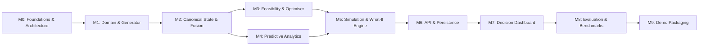

# AIRWISE Master Roadmap

## 1. Overview & Strategy

The AIRWISE project is delivered through a milestone-driven, dependency-aware roadmap designed to yield a verifiable, scientifically sound decision-support prototype. The system progresses from foundational domain modeling and deterministic synthetic data generation, through formal constraint optimization and predictive modeling, to full counterfactual simulation, API integration, and an interactive UI.

---

## 2. Milestone Classification

| Tier | Milestones Included | Description | Target State |
| :--- | :--- | :--- | :--- |
| **Core MVP Demonstrator** | M0, M1, M2, M3, M4, M5, M6, M7 | Complete end-to-end pipeline: generation, fusion, prediction, CP-SAT optimization, what-if comparison, REST API, and interactive dashboard. | Mandatory for initial functional sign-off |
| **Scientific Validation** | M8 | Rigorous benchmarking against baselines, scalability tests, Pareto analysis, statistical significance tests. | Mandatory for scientific credibility |
| **Release & Packaging** | M9 | Seeded demonstration packages, zero-friction setup scripts, reproducible walkthrough guides. | Mandatory for public presentation |
| **Future Extensions** | Post-M9 (v1.1+) | Multi-base network routing, stochastic programming, online continuous replanning, distributed database clustering. | Post-MVP Exploratory |

---

## 3. Milestone Specifications

### Milestone 0: Repository Foundations & Architectural Freezing
- **Objective:** Establish the development environment, Git hygiene, project governance, and comprehensive architectural documentation.
- **Scope:** Repository configuration, directory scaffolding, `.gitignore`, `.env.example`, architectural blueprints, ADRs, requirements traceability, and task audit checklists.
- **Expected Deliverables:** Complete documentation suite (`README.md`, `ARCHITECTURE.md`, `ROADMAP.md`, `PHASES.md`, `COMPLETION.md`, `REQUIREMENTS.md`, `DECISIONS.md`, `CONTRIBUTING.md`).
- **Dependencies:** None.
- **Acceptance Criteria:** Repository initialized on `main` branch, remote origin linked, all documentation cross-referenced and validated without circular ambiguities.
- **Validation Approach:** Manual document inspection, linting check, git remote connectivity check.
- **Definition of Done:** All Phase 0 tasks verified complete in `COMPLETION.md`.
- **Risks & Open Questions:** None. Foundational clarity established.

---

### Milestone 1: Domain Modeling & Synthetic Scenario Generation Engine
- **Objective:** Model the air operations resource domain and generate rich, deterministic, referentially intact synthetic operational scenarios.
- **Scope:**
  - Entities: `Airbase`, `Runway`, `Aircraft`, `AirframeType`, `CrewMember`, `CrewQualification`, `MaintenanceBay`, `FuelDepot`, `OperationalTask`, `WeatherWindow`.
  - Pydantic v2 schemas and validation rules.
  - Deterministic generator with seed controls, configurable operational scales (Small: 10 sorties, Medium: 50 sorties, Large: 200 sorties), and injected stress parameters.
- **Expected Deliverables:** `src/domain/models.py`, `src/generator/scenario_generator.py`, automated tests in `tests/unit/test_generator.py`.
- **Dependencies:** M0.
- **Acceptance Criteria:** 100% referential integrity across tasks, crew, and assets. Generated datasets reproducible under identical random seeds. 0 dangling foreign keys.
- **Validation Approach:** Automated property-based assertions and unit tests.
- **Definition of Done:** Test coverage > 90% for domain schemas and scenario generators.

---

### Milestone 2: Operational State Management & Data Fusion
- **Objective:** Ingest disparate simulated data feeds (telemetry, weather updates, maintenance logs) and fuse them into a single, canonical, timestamped operational state.
- **Scope:**
  - Data ingestion adapters for synthetic sensor and log streams.
  - Conflict resolution rules (e.g. latest timestamp wins, manual override precedence).
  - Immutable historical event log and snapshotting engine.
- **Expected Deliverables:** `src/state/canonical_state.py`, `src/state/fusion_engine.py`, `src/state/events.py`.
- **Dependencies:** M1.
- **Acceptance Criteria:** Ingestion errors caught with structured diagnostic reports. State queries run in sub-millisecond memory lookups.
- **Validation Approach:** Unit tests simulating out-of-order events, network dropped packets, and conflicting telemetry feeds.
- **Definition of Done:** Fusion engine deterministic and validated across 5 distinct scenario variations.

---

### Milestone 3: Feasibility Engine & Constraint Optimisation Baseline
- **Objective:** Implement the formal constraint programming optimization model using Google OR-Tools CP-SAT alongside a transparent greedy heuristic baseline.
- **Scope:**
  - Hard constraint formulation (pilot flight-hour limits, aircraft capability matching, maintenance window exclusion, runway throughput).
  - Soft objective formulation (delay minimization, priority-weighted task completion, aircraft flight hour balancing).
  - Unified `SolverInterface` decoupling solver implementation from caller logic.
  - Transparent Greedy Baseline algorithm for comparative benchmarking.
- **Expected Deliverables:** `src/optimization/solver_interface.py`, `src/optimization/cp_sat_solver.py`, `src/optimization/greedy_solver.py`, `src/optimization/objectives.py`.
- **Dependencies:** M1, M2.
- **Acceptance Criteria:** Zero hard-constraint violations in feasible scenarios. Fallback handling and diagnostic logs generated if scenario is mathematically over-constrained.
- **Validation Approach:** Solvers executed on standardized benchmark scenarios; output verified by independent constraint audit functions.
- **Definition of Done:** CP-SAT solver delivers provably superior or equal objective value compared to greedy heuristic across all test cases.

---

### Milestone 4: Calibrated Predictive Intelligence
- **Objective:** Train and calibrate predictive models to forecast operational disruptions (equipment unscheduled maintenance probability, flight turnaround delays, weather degradation).
- **Scope:**
  - Feature engineering pipeline operating on canonical state and historical logs.
  - Supervised learning baselines (Logistic Regression / Ridge) and gradient boosted trees (LightGBM / scikit-learn HistGradientBoosting).
  - Probability calibration (Platt scaling / Isotonic regression) and Brier score evaluation.
  - Integration with the optimization model (e.g. buffer insertion based on predicted delay risk).
- **Expected Deliverables:** `src/prediction/features.py`, `src/prediction/models.py`, `src/prediction/pipeline.py`, offline training scripts.
- **Dependencies:** M2.
- **Acceptance Criteria:** Predictive models beat naive historical average baseline by >= 15% on ROC-AUC and MAE. Predictions properly calibrated (calibration curve slope within [0.85, 1.15]).
- **Validation Approach:** Out-of-time and k-fold cross-validation on synthetic scenario event logs.
- **Definition of Done:** Models saved, versioned, and loadable via pure Python inference without training-time dependencies.

---

### Milestone 5: Scenario Simulation & Counterfactual What-If Engine
- **Objective:** Enable operators to clone existing operational plans, introduce hypothetical disruptions, re-run optimization, and compare delta outcomes.
- **Scope:**
  - Deep cloning of canonical states and schedules.
  - Disruption injection operators: `ground_aircraft(id)`, `close_runway(id, window)`, `incapacitate_crew(id)`, `inject_weather_front(corridor, severity)`.
  - Differential comparison engine calculating delta completed tasks, delay shifts, and reallocation ripple effects.
- **Expected Deliverables:** `src/simulation/what_if_engine.py`, `src/simulation/disruptions.py`, `src/simulation/diff_analyzer.py`.
- **Dependencies:** M3, M4.
- **Acceptance Criteria:** State mutation completely isolated from baseline plan. Deterministic replay of what-if mutations.
- **Validation Approach:** Automated stress testing of counterfactual branches against ground truth.
- **Definition of Done:** Multi-branch simulation runs reliably with full auditable diffs.

---

### Milestone 6: REST API & Persistence Layer
- **Objective:** Wrap operational capabilities in a secure, high-performance FastAPI service backed by relational storage.
- **Scope:**
  - REST endpoints for scenario management, state inspection, solver triggering, prediction queries, and counterfactual comparisons.
  - SQLAlchemy 2.0 ORM persistence with SQLite / PostgreSQL compatibility.
  - Pydantic request/response validation with clear OpenAPI/Swagger documentation.
- **Expected Deliverables:** `src/api/main.py`, `src/api/routes/*.py`, `src/db/models.py`, `src/db/session.py`.
- **Dependencies:** M1, M2, M3, M4, M5.
- **Acceptance Criteria:** Sub-100ms response time for state and diff endpoints (excluding solver search execution). Clean HTTP error handling and status codes.
- **Validation Approach:** API integration tests using FastAPI `TestClient`.
- **Definition of Done:** Automated API test suite passing with 100% endpoint coverage.

---

### Milestone 7: Interactive Decision-Support Dashboard
- **Objective:** Provide human planners with an intuitive, responsive web interface for inspecting operational states, viewing allocations, and performing what-if analysis.
- **Scope:**
  - React 18 + TypeScript + Vite + Tailwind CSS.
  - Interactive Gantt chart for aircraft and crew schedule visualization.
  - Resource health and utilization widgets.
  - Disruption builder modal (drag-and-drop or form-based event injection).
  - Side-by-side comparative analysis view showing pre- and post-disruption KPIs.
- **Expected Deliverables:** Complete `frontend/` application with typed API clients and modular components.
- **Dependencies:** M6.
- **Acceptance Criteria:** UI loads scenario in < 1s, responds cleanly to re-optimization triggers, and visually highlights constraint conflicts and plan differences.
- **Validation Approach:** Component unit tests, end-to-end user flow tests.
- **Definition of Done:** Dashboard fully operational and integrated with backend API.

---

### Milestone 8: Integrated Evaluation & Experimental Benchmarks
- **Objective:** Conduct rigorous experimental evaluation measuring solver scalability, solution quality, baseline comparisons, and predictive calibration.
- **Scope:**
  - Parametric benchmark suite varying scenario size (10, 50, 100, 250 tasks) and disruption severity.
  - Generation of publication-grade metrics tables and Pareto trade-off curves.
  - Documented findings in an experimental report.
- **Expected Deliverables:** `experiments/run_benchmarks.py`, `experiments/results/*.json`, automated reporting scripts.
- **Dependencies:** M6, M7.
- **Acceptance Criteria:** Comprehensive comparison across 3 distinct algorithmic configurations; execution time and optimality gap recorded accurately.
- **Validation Approach:** Automated headless execution on standardized seed batches.
- **Definition of Done:** Experimental findings reviewed and documented in `README.md` and evaluation artifacts.

---

### Milestone 9: Demonstration Readiness & Packaging
- **Objective:** Deliver a turnkey, zero-friction local installation with pre-configured demonstration scripts.
- **Scope:**
  - One-command startup script for local full-stack execution.
  - Curated demo scenarios showcasing nominal operations, severe thunderstorm rerouting, and sudden airframe failure re-allocation.
  - Video walkthrough or illustrated step-by-step documentation.
- **Expected Deliverables:** `run_demo.py`, launch scripts, documentation updates.
- **Dependencies:** M7, M8.
- **Acceptance Criteria:** Clean environment clone and run in under 3 minutes with verified UI and backend responsiveness.
- **Validation Approach:** Fresh containerized or clean-system validation run.
- **Definition of Done:** Final release tag and verification audit completed.
