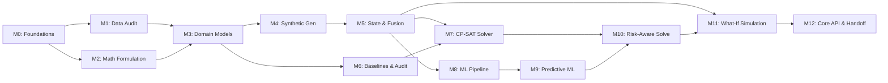

# AIRWISE Master Roadmap (Milestones M0 to M12)

**Project:** AIRWISE — AI-Enabled Dynamic Air Operations & Resource Optimisation  
**SIH Problem Statement:** SIH 26250  
**Document Status:** Complete & Aligned with 13 Implementation Phases  
**Architects:** Lakshay Bharti, Nakshatra Yadav, Nidhi Jha  

---

## 1. Strategic Roadmap Overview

The AIRWISE master roadmap delivers a complete computational decision-support prototype across 13 structured, dependency-aware milestones. The system establishes rigorous mathematical and data foundations, progresses through constraint optimization and calibrated machine learning, and culminates in full counterfactual simulation, API packaging, and frontend team handoff.

---

## 2. Milestone Classification & Ownership

| Milestone ID | Title | Corresponding Phase | Primary Owner | Target Deliverable |
| :--- | :--- | :--- | :--- | :--- |
| **M0** | **Foundations & Architecture Freezing** | Phase 0 | All (Lakshay Lead) | Architecture blueprints, 13-phase plan, workstream specs |
| **M1** | **Dataset Discovery & Security Audit** | Phase 1 | Nakshatra Yadav | `docs/data-audit.md`, safe ingestion loader (<50MB guard) |
| **M2** | **Formal Problem & Math Formulation** | Phase 2 | Lakshay Bharti | `docs/optimisation-design.md`, `docs/prediction-design.md` |
| **M3** | **Canonical Domain Models & Schemas** | Phase 3 | Nakshatra Yadav | Pydantic v2 domain models in `src/domain/`, frozen contracts |
| **M4** | **Synthetic Scenario Generator Engine**| Phase 4 | Nakshatra Yadav | Procedural generator in `src/generator/`, demo fixtures |
| **M5** | **State Management & Event Fusion** | Phase 5 | Nakshatra Yadav | Canonical state in `src/state/`, deterministic event replay |
| **M6** | **Independent Feasibility & Baselines**| Phase 6 | Nidhi Jha | `FeasibilityAuditor` and `GreedyBaselineSolver` |
| **M7** | **CP-SAT Constraint Programming Solver**| Phase 7 | Lakshay Bharti | Google OR-Tools CP-SAT solver in `src/optimization/` |
| **M8** | **Leakage-Free ML Training Pipeline** | Phase 8 | Lakshay Bharti | Feature extraction with timestamp guards, temporal splits |
| **M9** | **Predictive Model Benchmarking** | Phase 9 | Lakshay Bharti | Calibrated LightGBM models in `src/prediction/` |
| **M10** | **Prediction-Aware Optimisation** | Phase 10 | Lakshay Bharti & Nidhi Jha | Dynamic risk penalty & delay buffer integration |
| **M11** | **What-If Simulation & Robustness** | Phase 11 | Nidhi Jha | Counterfactual sandbox & `PlanDiffAnalyzer` in `src/simulation/` |
| **M12** | **Core API Release & Frontend Handoff**| Phase 12 | All Leads | Production FastAPI backend, OpenAPI spec, test suite |

---

## 3. Detailed Milestone Specifications

### Milestone 0: Foundations & Architecture Freezing (Phase 0)
- **Objective:** Finalize architecture, mathematical models, dataset research, and three-person workstream specifications.
- **Deliverables:** `ARCHITECTURE.md`, `PHASES.md`, `ROADMAP.md`, `COMPLETION.md`, `REQUIREMENTS.md`, `DECISIONS.md`, `CONTRIBUTING.md`, `Lakshay.md`, `Nakshatra.md`, `Nidhi.md`, `docs/*`.
- **Definition of Done:** Documentation verified, clean Git working tree on `main`, remote origin synchronized.

### Milestone 1: Dataset Discovery, Audit & Security (Phase 1)
- **Objective:** Complete evidence-backed audit of candidates A through H, establish Option B hybrid strategy, and implement safe ingestion guards.
- **Deliverables:** `docs/data-audit.md`, `src/data/adapters.py`, `src/data/safe_loader.py`.
- **Definition of Done:** Decompression bomb and Zip-Slip tests passing, formal audit signed off.

### Milestone 2: Formal Problem & Mathematical Formulation (Phase 2)
- **Objective:** Specify exact decision variables, hard constraints, soft penalties, and integer scaling bounds for CP-SAT and ML targets.
- **Deliverables:** `docs/optimisation-design.md`, `docs/prediction-design.md`.
- **Definition of Done:** Mathematical formulation approved by all three leads.

### Milestone 3: Canonical Domain Models & Data Contracts (Phase 3)
- **Objective:** Implement and freeze strongly-typed Pydantic v2 schemas for all operational entities and events.
- **Deliverables:** `src/domain/models.py`, `src/domain/schemas.py`, `docs/data-model.md`.
- **Definition of Done:** 100% schema unit test pass, signed off as frozen before parallel branch development.

### Milestone 4: Synthetic Scenario & Event Generation (Phase 4)
- **Objective:** Implement deterministic procedural generator synthesizing operational scenarios with 100% referential integrity.
- **Deliverables:** `src/generator/scenario_generator.py`, `src/generator/profiles.py`, `data/scenarios/`.
- **Definition of Done:** Byte-identical reproduction across repeat seeds, 0 dangling references.

### Milestone 5: State Management, Ingestion, Fusion & Replay (Phase 5)
- **Objective:** Build in-memory canonical state container and deterministic event replay engine.
- **Deliverables:** `src/state/canonical_state.py`, `src/state/events.py`, `src/state/fusion_engine.py`.
- **Definition of Done:** Out-of-order event replay hash equivalence verified, $< 1$ms entity lookup latency.

### Milestone 6: Independent Feasibility & Baseline Allocators (Phase 6)
- **Objective:** Implement the independent constraint feasibility auditor and transparent Greedy baseline solver.
- **Deliverables:** `src/evaluation/auditor.py`, `src/baselines/greedy_solver.py`.
- **Definition of Done:** Auditor flags invalid schedules with 100% recall, Greedy baseline runs in $< 50$ms.

### Milestone 7: CP-SAT Constraint Programming Solver (Phase 7)
- **Objective:** Implement Google OR-Tools CP-SAT solver, enforce interval disjunctions, and benchmark against Greedy.
- **Deliverables:** `src/optimization/cp_sat_solver.py`, `src/optimization/objectives.py`.
- **Definition of Done:** Zero hard constraint violations verified by auditor, CP-SAT objective $\ge$ Greedy on 20 test instances.

### Milestone 8: Leakage-Free ML Training Pipeline (Phase 8)
- **Objective:** Implement temporal feature extraction with strict timestamp cut-offs and chronological train/test splits.
- **Deliverables:** `src/prediction/features.py`, `src/prediction/train.py`.
- **Definition of Done:** Automated leakage guard unit tests passing with zero future observations in feature vectors.

### Milestone 9: Predictive Model Benchmarking & Calibration (Phase 9)
- **Objective:** Train and calibrate LightGBM models for failure probability and turnaround delays, exporting pure-Python inference service.
- **Deliverables:** `src/prediction/models.py`, `src/prediction/service.py`, `models/checkpoints/`.
- **Definition of Done:** ROC-AUC $\ge 0.75$, Brier score $\le 0.15$, inference latency $< 20$ms on CPU.

### Milestone 10: Prediction-Aware Rolling-Horizon Optimisation (Phase 10)
- **Objective:** Connect calibrated predictions to solver objective and interval buffers, experimentally verifying downstream decision benefit.
- **Deliverables:** `src/optimization/risk_aware_solver.py`, `experiments/reports/prediction_value.md`.
- **Definition of Done:** Downstream mission abort reduction $\ge 30\%$ and delay reduction $\ge 20\%$ proven over reactive baseline.

### Milestone 11: What-If Simulation, Robustness & Evaluation (Phase 11)
- **Objective:** Build isolated sandbox cloning, disruption injection operators, dynamic re-optimization, and Plan Diff Analyzer.
- **Deliverables:** `src/simulation/sandbox.py`, `src/simulation/diff_analyzer.py`, `experiments/benchmark_runner.py`.
- **Definition of Done:** Sandbox isolation verified (0 mutation on baseline), diff analyzer outputs verified, evaluation report complete.

### Milestone 12: Core API Contracts, Release & Frontend Handoff (Phase 12)
- **Objective:** Expose complete system via FastAPI REST endpoints, achieve $\ge 85\%$ test coverage, export OpenAPI specs, and hand off to frontend team.
- **Deliverables:** `src/api/main.py`, `src/api/routes/*.py`, `tests/integration/test_api_endpoints.py`, `docs/FRONTEND_HANDOFF.md`.
- **Definition of Done:** Full test suite passing, OpenAPI contracts frozen and exported, release tag `v1.0.0` registered.
