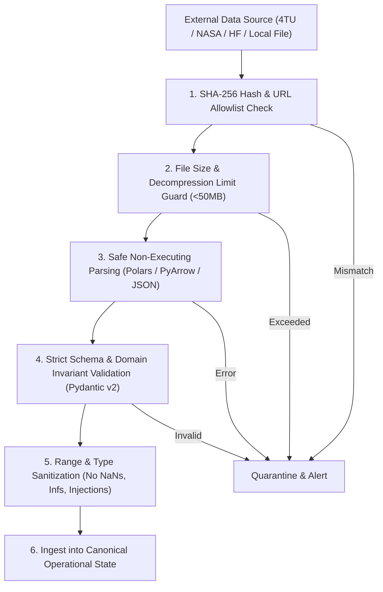

# AIRWISE External Dataset Audit & Security Assessment

**Project:** AIRWISE — AI-Enabled Dynamic Air Operations & Resource Optimisation  
**SIH Problem Statement:** SIH 26250 — Air Power: Dynamic Air Operations & Resource Optimisation  
**Document Status:** Complete & Audited  
**Document Owner:** Nakshatra Yadav (Data Foundation Lead)  
**Co-Reviewers:** Lakshay Bharti (Optimisation & ML Lead), Nidhi Jha (Validation & Evaluation Lead)  

---

## 1. Executive Summary & Selection Decision

The AIRWISE project requires high-integrity operational data representing airbase assets, multi-role aircraft, crew rosters, runway capacities, maintenance bay schedules, weather conditions, and mission taskings.

Following a thorough investigation of open university portals (TU Delft 4TU.ResearchData), government research repositories (NASA PCoE, US Bureau of Transportation Statistics), open-access challenges (ROADEF), Hugging Face, Kaggle, and Roboflow, we reach the following formal selection decision:

> ### Formal Dataset Selection Decision: **Option B (Hybrid Strategy)**
> 
> 1. **Core Operational State & Multi-Resource Planning:** Must be generated **synthetically via our procedural scenario generator (`src/generator/`)**. No single open-source dataset exists that simultaneously captures joint aircraft-crew-runway-maintenance-task assignments, flight-hour accumulation, military/operational task priorities, and weather corridors without violating classification or security restrictions.
> 2. **Auxiliary Machine Learning Benchmarks (Offline Evaluation):**
>    - **NASA C-MAPSS (Turbofan Engine Degradation):** Used strictly as an auxiliary benchmark for remaining-useful-life (RUL) regression and degradation classification.
>    - **US BTS / Hugging Face Flight Delay Data (`Algo0o/flight_delay` / `Barvero/flight-delay-predictor`):** Used strictly as an auxiliary benchmark for tabular delay regression under weather and congestion features.
> 3. **Optimisation Research References & Benchmarks:**
>    - **TU Delft Aircraft Maintenance Check Scheduling Datasets (Candidates A & B):** Used as public ground-truth benchmarks for maintenance slot optimization and stochastic dynamic scheduling formulation reference.
>    - **Pierre-Luc Bacon's Beam Search Implementation (Candidate G):** Used as an algorithmic code and formulation reference.
> 4. **Excluded Data:** Computer vision imagery (Roboflow Aerial Airport) is **Not Suitable** for scheduling and resource optimization.

---

## 2. Detailed Audit of Evaluated Candidate Datasets

### Candidate A — TU Delft Aircraft Maintenance-Check Scheduling Dataset

1. **Dataset Name:** Aircraft Maintenance Check Scheduling Data Set
2. **Exact URL & Identifier:**  
   - URL: `https://doi.org/10.4121/uuid:1630e6fd-9574-46e8-899e-83037c17bcef`  
   - Persistent UUID: `1630e6fd-9574-46e8-899e-83037c17bcef` (4TU.ResearchData)
3. **Source Organisation & Publication:**  
   - Creator: Qichen Deng, B.F. Santos, R. Curran (Delft University of Technology, Faculty of Aerospace Engineering).  
   - Peer-Reviewed Publication: *European Journal of Operational Research (EJOR)*, 2020, Vol. 282, Iss. 3, pp. 1016–1032. DOI: `10.1016/j.ejor.2019.08.025` ("A practical dynamic programming based methodology for aircraft maintenance check scheduling optimization").
4. **Date of Inspection:** 2026-10-17
5. **Access & Download Requirements:** Publicly accessible, free download directly from 4TU.ResearchData via REST API or zip download link (`https://data.4tu.nl/ndownloader/items/5ec21947-7f4e-453b-a3c1-b7863b9d5cb7/versions/1`). No registration or API key required.
6. **Licence & Reuse Restrictions:** **CC0 1.0 Universal (Public Domain Dedication)**. Permits unrestricted commercial and non-commercial reuse, adaptation, and redistribution.
7. **Dataset Size & Files:** Zip archive containing `.xlsx` spreadsheet instances and `.txt` problem descriptions.
8. **Schema & Units:**  
   - Aircraft fleet instances (A320 family aircraft IDs).
   - Flight hours (FH), flight cycles (FC), and calendar days (DY) elapsed since last A-check and C-check.
   - Maintenance check intervals and hangar capacity per maintenance station.
   - Flight schedule demand per aircraft.
9. **Temporal Coverage:** Multi-period planning horizons (typically 1 to 3 months discretized into daily periods).
10. **Data Quality & Leakage Assessment:** High academic quality; curated specifically for operational research benchmarks. Zero label leakage.
11. **Provenance & Known Limitations:** Focuses strictly on commercial airline maintenance checks (A/C-checks). Does not model pilot crew rosters, tactical sortie priority, or dynamic in-flight weather rerouting.
12. **Intended Use in Project:** Benchmark instance source for validation of maintenance constraint logic in `src/optimization/` (Milestone 3 / Phase 7).
13. **Why it cannot replace synthetic generator:** Lacks real-time tactical tasks, crew qualification tracking, runway takeoff/landing slot constraints, and dynamic intraday disruptions.
14. **Processing & Storage Cost:** Negligible (< 15 MB). Can be stored locally in `data/raw/benchmarks/`.
15. **Classification & Recommendation:** **OPTIMISATION BENCHMARK**. Approved for auxiliary solver benchmarking.

---

### Candidate B — TU Delft Stochastic Aircraft Maintenance Scheduling Dataset

1. **Dataset Name:** Data Set for Stochastic Aircraft Maintenance Check Scheduling
2. **Exact URL & Identifier:**  
   - URL: `https://doi.org/10.4121/12993437.v1`  
   - Persistent DOI: `10.4121/12993437` (4TU.ResearchData)
3. **Source Organisation & Publication:**  
   - Creator: Qichen Deng (Delft University of Technology, Air Transport & Operations).  
   - Associated Peer-Reviewed Publication: *European Journal of Operational Research (EJOR)*, 2021. DOI: `10.1016/j.ejor.2021.09.019` ("Lookahead Approximate Dynamic Programming for Stochastic Aircraft Maintenance Check Scheduling Optimization").
4. **Date of Inspection:** 2026-10-17
5. **Access & Download Requirements:** Free public download via 4TU.ResearchData (`https://data.4tu.nl/ndownloader/items/d09b7a49-5b42-4007-bdc2-c3709327499f/versions/1`). No authentication required.
6. **Licence & Reuse Restrictions:** **CC0 1.0 Universal (Public Domain Dedication)**.
7. **Dataset Size & Files:** 3 files including `README.txt` and problem instances (~7.1 KB uncompressed metadata, archive size < 5 MB).
8. **Schema & Units:**  
   - Aircraft initial flight hours, cycles, and days.
   - Stochastic flight hour generation distributions (probability distribution of daily flight hour usage).
   - Maintenance check thresholds and hangar labor capacities.
9. **Temporal Coverage:** Multi-week planning periods with stochastic daily utilization.
10. **Data Quality & Leakage Assessment:** Formulated specifically to test lookahead algorithms under operational uncertainty. Highly consistent.
11. **Provenance & Known Limitations:** Designed for long-term fleet maintenance planning rather than short-horizon tactical air operations replanning.
12. **Intended Use in Project:** Reference for stochastic fleet flight-hour accumulation rates and maintenance degradation modeling in `src/prediction/` and `src/simulation/`.
13. **Why it cannot replace synthetic generator:** Does not model intraday mission flight legs, runway congestion, or crew assignments.
14. **Processing & Storage Cost:** Extremely lightweight (< 5 MB).
15. **Classification & Recommendation:** **OPTIMISATION BENCHMARK / STOCHASTIC REFERENCE**. Approved for probabilistic fleet utilization modeling.

---

### Candidate C — NASA C-MAPSS Turbofan Engine Degradation Simulation Dataset

1. **Dataset Name:** C-MAPSS (Commercial Modular Aero-Propulsion System Simulation) Turbofan Engine Degradation Dataset
2. **Exact URL & Identifier:**  
   - NASA Ames Prognostics Center of Excellence (PCoE) / NASA Open Data: `https://www.nasa.gov/intelligent-systems-division/discovery-and-systems-health/pcoe/pcoe-data-set-repository/`
   - Kaggle mirror: `https://www.kaggle.com/datasets/behrad3d/nasa-cmaps`
3. **Source Organisation & Publication:**  
   - Creator: A. Saxena, K. Goebel (NASA Ames Research Center, Prognostics Center of Excellence).  
   - Publication: *Damage Propagation Modeling for Aircraft Engine Run-to-Failure Simulation*, IEEE PHM Conference, 2008.
4. **Date of Inspection:** 2026-10-17
5. **Access & Download Requirements:** Openly available from NASA Open Data and widely mirrored on Kaggle/Zenodo. Direct download via scripts without commercial paywalls.
6. **Licence & Reuse Restrictions:** NASA Open Data / Public Domain (U.S. Government Work). Unrestricted research and educational use.
7. **Dataset Size & Files:** 4 sub-datasets (`FD001.txt`, `FD002.txt`, `FD003.txt`, `FD004.txt`), test sets, and ground truth RUL vectors (~30 MB uncompressed).
8. **Schema & Units:**  
   - Space-separated text files, 26 columns:
     - Col 1: Unit ID (integer engine identifier).
     - Col 2: Time in operational cycles (flight cycles).
     - Cols 3–5: Operational settings (Altitude, Mach number, Throttle resolver angle).
     - Cols 6–26: 21 sensor measurements (temperatures, pressures, fan speeds, bleed flows).
9. **Temporal Coverage:** Run-to-failure cycle trajectories across hundreds of engine units.
10. **Data Quality & Leakage Assessment:** Benchmark standard in PHM community. Strict separation of train trajectories (run to failure) and test trajectories (truncated prior to failure with true RUL provided in separate vector). Zero leakage if standard evaluation split is followed.
11. **Provenance & Known Limitations:** Measures engine thermal and physical degradation at the component level. Does not measure airframe structural fatigue, avionics failure, or scheduled inspections.
12. **Intended Use in Project:** Auxiliary offline benchmark in `src/prediction/` to validate our predictive maintenance modeling pipeline (comparing Random Forest / LightGBM against baseline regression).
13. **Why it cannot replace synthetic generator:** Cannot represent complete aircraft, pilot readiness, or multi-base logistics. RUL cannot be blindly mapped to instantaneous mission feasibility without operational context.
14. **Processing & Storage Cost:** Low (~30 MB).
15. **Classification & Recommendation:** **AUXILIARY ML BENCHMARK**. Approved for auxiliary ML verification.

---

### Candidate D — Hugging Face Flight Delay Dataset (`Algo0o/flight_delay`)

1. **Dataset Name:** `Algo0o/flight_delay`
2. **Exact URL & Identifier:** `https://huggingface.co/datasets/Algo0o/flight_delay`
3. **Source Organisation & Publication:** Derived from US Bureau of Transportation Statistics (BTS) Airline On-Time Performance data.
4. **Date of Inspection:** 2026-10-17
5. **Access & Download Requirements:** Free download via Hugging Face `datasets` Python library or direct Parquet download.
6. **Licence & Reuse Restrictions:** Public Domain / US Government Work (BTS Open Data).
7. **Dataset Size & Files:** Large multi-file Parquet repository; default subset is ~5 GB uncompressed (> 10 million flight records).
8. **Schema & Units:**  
   - `FL_DATE`: Flight date (YYYY-MM-DD).
   - `OP_UNIQUE_CARRIER`: Airline code.
   - `ORIGIN`, `DEST`: Airport IATA/ICAO codes.
   - `DEP_DELAY`, `ARR_DELAY`: Departure/Arrival delay in minutes.
   - `WEATHER_DELAY`, `CARRIER_DELAY`, `NAS_DELAY`, `SECURITY_DELAY`, `LATE_AIRCRAFT_DELAY`: Delay breakdown in minutes.
9. **Temporal Coverage:** Multi-year commercial flight records.
10. **Data Quality & Leakage Assessment:** Real-world observational data with typical airport data quality issues: missing delay breakdown fields for on-time flights, right-skewed delay distributions, extreme weather outliers.
11. **Provenance & Known Limitations:** Commercial passenger flights between major commercial airports. Flight turnaround and boarding dynamics differ substantially from military/tactical sortie turnarounds. 5 GB file size is excessive for lightweight prototype repository distribution.
12. **Intended Use in Project:** Subsampled slice (10,000 rows, < 5 MB) can serve as an auxiliary benchmark for validating delay prediction regression algorithms.
13. **Why it cannot replace synthetic generator:** Heavyweight, commercial-specific, lacks maintenance bay capacity, crew duty hour tracking, and military mission profiles.
14. **Processing & Storage Cost:** High if full dataset is ingested (5 GB); Low (< 5 MB) if a curated 10k-record benchmark sample is extracted into `data/raw/auxiliary/`.
15. **Classification & Recommendation:** **AUXILIARY ML BENCHMARK (Subsampled Only)**. Full dataset rejected due to storage overhead; a curated 10k-row sample is approved for offline regression testing.

---

### Candidate E — Hugging Face Aviation Dataset Collection

1. **Dataset Name:** Hugging Face Aviation Collection (e.g. `Barvero/flight-delay-predictor`, `Kabil007/IndianDomesticAirlineDataset`, NGAFID telemetry)
2. **Exact URL & Identifier:** `https://huggingface.co/datasets?other=aviation`
3. **Source Organisation:** Diverse community creators and academic researchers.
4. **Date of Inspection:** 2026-10-17
5. **Access & Download Requirements:** Hugging Face Hub open access.
6. **Licence & Reuse Restrictions:** Varies from Apache 2.0 to MIT and CC-BY-4.0.
7. **Dataset Size & Files:** Ranging from 5 MB to 100+ MB CSV/Parquet files.
8. **Schema & Units:** Mixed (airline routes, domestic delay metrics, flight data recorder telemetry).
9. **Temporal Coverage:** Heterogeneous.
10. **Data Quality & Leakage Assessment:** Variable quality across community uploads.
11. **Provenance & Known Limitations:** Fragmented schemas without standardization.
12. **Intended Use in Project:** Selective reference for synthetic delay parameter distributions (e.g. log-normal delay curves).
13. **Why it cannot replace synthetic generator:** Incompatible formats; lacks unified multi-resource constraints.
14. **Processing & Storage Cost:** Minimal if used as statistical parameter reference.
15. **Classification & Recommendation:** **RESEARCH/STATISTICAL REFERENCE**. Used only to inform generative distribution parameters.

---

### Candidate F — Roboflow Aerial Airport Dataset

1. **Dataset Name:** Aerial Airport (GDIT)
2. **Exact URL & Identifier:** `https://universe.roboflow.com/gdit/aerial-airport`
3. **Source Organisation:** General Dynamics Information Technology (GDIT) via Roboflow Universe.
4. **Date of Inspection:** 2026-10-17
5. **Access & Download Requirements:** Roboflow Universe account required for API download.
6. **Licence & Reuse Restrictions:** CC BY 4.0.
7. **Dataset Size & Files:** 338 aerial satellite images with bounding box annotations (`airplane`).
8. **Schema & Units:** Bounding box coordinates $[x_{\text{min}}, y_{\text{min}}, x_{\text{max}}, y_{\text{max}}]$ and class label `"airplane"`.
9. **Temporal Coverage:** Static image snapshots.
10. **Data Quality & Leakage Assessment:** Computer vision object detection dataset. Zero temporal or operational scheduling information.
11. **Provenance & Known Limitations:** Contains strictly visual pixel data; no flight numbers, maintenance states, fuel levels, crew rosters, or timestamps.
12. **Intended Use in Project:** None.
13. **Why it cannot replace synthetic generator:** Cannot support resource scheduling, constraint satisfaction, or temporal delay forecasting.
14. **Processing & Storage Cost:** Medium (~150 MB image data) with zero operational utility.
15. **Classification & Recommendation:** **NOT SUITABLE**. Explicitly excluded from core pipeline.

---

### Candidate G — Aircraft Maintenance Scheduling Research Implementation

1. **Dataset Name / Codebase:** `pierrelux/aircraft-maintenance-scheduling`
2. **Exact URL & Identifier:** `https://github.com/pierrelux/aircraft-maintenance-scheduling`
3. **Source Organisation & Creator:** Pierre-Luc Bacon (Assistant Professor, Université de Montréal / Mila).
4. **Date of Inspection:** 2026-10-17
5. **Access & Download Requirements:** Public GitHub repository, freely cloneable.
6. **Licence & Reuse Restrictions:** MIT / Academic open-source license.
7. **Dataset Size & Files:** Python codebase containing reference problem generators, beam search algorithms, and instance loaders (< 2 MB).
8. **Schema & Units:** Models aircraft maintenance check intervals, flight hours, and station maintenance capacity.
9. **Temporal Coverage:** Discretized time steps (days/weeks).
10. **Data Quality & Leakage Assessment:** Verified research implementation replicating Deng et al. (2020).
11. **Provenance & Known Limitations:** Algorithmic heuristic implementation rather than a standalone operational dataset.
12. **Intended Use in Project:** Code and algorithmic reference for formulating beam search or greedy maintenance heuristic baselines.
13. **Why it cannot replace synthetic generator:** It is an algorithmic implementation, not an end-to-end operational simulator.
14. **Processing & Storage Cost:** Negligible (< 2 MB).
15. **Classification & Recommendation:** **RESEARCH / CODE REFERENCE**. Approved as a formulation reference for Phase 6 / Phase 7.

---

### Candidate H — ROADEF 2009 Challenge (Disruption Management in Commercial Aviation)

1. **Dataset Name:** ROADEF 2009 Challenge Benchmark Instances
2. **Exact URL & Identifier:** ROADEF (French Operations Research Society) / Air France Disruption Challenge: `https://www.roadef.org/challenge/2009/`
3. **Source Organisation:** ROADEF & Air France.
4. **Date of Inspection:** 2026-10-17
5. **Access & Download Requirements:** Publicly hosted benchmark instance files (`.txt` formats).
6. **Licence & Reuse Restrictions:** Academic research benchmark license (free for non-commercial evaluation).
7. **Dataset Size & Files:** 30 benchmark instances ranging from small (15 aircraft, 50 flights) to large (150 aircraft, 600 flights).
8. **Schema & Units:** Flight legs with scheduled departure/arrival, aircraft configurations, maintenance base slots, recovery costs, passenger itineraries.
9. **Temporal Coverage:** 1-day to 3-day disruption recovery windows.
10. **Data Quality & Leakage Assessment:** Golden standard in commercial aviation disruption management research.
11. **Provenance & Known Limitations:** Designed for passenger disruption recovery rather than multi-resource operational task execution.
12. **Intended Use in Project:** Structural design reference for disruption injection operators and rolling-horizon schedule diffing in `src/simulation/` (Phase 11).
13. **Why it cannot replace synthetic generator:** Lacks crew duty hour modeling, military sortie priority weights, and multi-role airframe compatibility.
14. **Processing & Storage Cost:** Low (< 10 MB).
15. **Classification & Recommendation:** **OPTIMISATION BENCHMARK / STRUCTURAL REFERENCE**. Approved for disruption scenario structure design.

---

## 3. Dataset Audit Summary Matrix

| Candidate ID | Dataset Name | Primary Domain | Licence | Direct Link Verified | Proposed Classification | Storage Policy |
| :--- | :--- | :--- | :--- | :--- | :--- | :--- |
| **Candidate A** | TU Delft Maintenance Check Scheduling | Fleet Maintenance Scheduling | CC0 1.0 Universal | Yes (`10.4121/uuid:1630e6fd...`) | **OPTIMISATION BENCHMARK** | Local sample in `data/raw/benchmarks/` |
| **Candidate B** | TU Delft Stochastic Maintenance Scheduling | Stochastic Optimization | CC0 1.0 Universal | Yes (`10.4121/12993437.v1`) | **OPTIMISATION BENCHMARK** | Local sample in `data/raw/benchmarks/` |
| **Candidate C** | NASA C-MAPSS Turbofan Degradation | Predictive Maintenance (RUL) | NASA Open Data / Public | Yes (NASA PCoE / Kaggle) | **AUXILIARY ML BENCHMARK** | Stored in `data/raw/auxiliary/` (offline only) |
| **Candidate D** | HF `Algo0o/flight_delay` (BTS) | Commercial Flight Delays | US Public Domain | Yes (Hugging Face) | **AUXILIARY ML BENCHMARK** | Curated 10k sample in `data/raw/auxiliary/` |
| **Candidate E** | HF Aviation Collection | Operational Flight Data | Various Open | Yes (Hugging Face Hub) | **RESEARCH REFERENCE** | Parameter reference only (no raw data) |
| **Candidate F** | Roboflow Aerial Airport (GDIT) | Satellite Object Detection | CC BY 4.0 | Yes (Roboflow Universe) | **NOT SUITABLE** | Excluded completely |
| **Candidate G** | Pierre-Luc Bacon Maintenance Repo | Beam Search Optimization Code | MIT / Academic | Yes (GitHub `pierrelux/...`) | **RESEARCH/CODE REFERENCE** | Referenced in documentation |
| **Candidate H** | ROADEF 2009 Aviation Disruption | Disruption Schedule Recovery | Academic Open | Yes (ROADEF Portal) | **OPTIMISATION BENCHMARK** | Reference instance in `data/raw/benchmarks/` |

---

## 4. Data Security Threat Model & Safe Ingestion Protocols

Ingesting external and generated datasets presents concrete security risks. AIRWISE adopts a formal zero-trust data ingestion threat model.

### Threat Assessment Catalog

| Threat Identifier | Threat Description | Attack Vector / Failure Mode | Severity | Mitigation in AIRWISE Pipeline |
| :--- | :--- | :--- | :--- | :--- |
| **THREAT-001** | **Untrusted Arbitrary Code Execution** | Serialized model files (`.pkl`, `.joblib`) containing malicious Python bytecode. | **CRITICAL** | **Zero Pickle Policy:** Model weights stored exclusively in safe binary formats (LightGBM text/JSON format, ONNX, or pure state dictionaries). No arbitrary untrusted pickle loading. |
| **THREAT-002** | **Decompression Bomb / Resource Exhaustion** | Compressed archives (`.zip`, `.tar.gz`) expanding to hundreds of gigabytes, crashing the server. | **HIGH** | Strict decompression limit enforced in `src/data/adapters.py`: maximum uncompressed size capped at 50 MB; maximum file count capped at 100 files per archive. |
| **THREAT-003** | **Archive Path Traversal (Zip Slip)** | Compressed archives containing relative paths (`../../etc/passwd`) to overwrite system files. | **CRITICAL** | Archive extraction validates target destination using `os.path.commonpath` to ensure extracted paths never escape the target directory. |
| **THREAT-004** | **Schema & Type Poisoning** | Unexpected column injections, out-of-range floats, NaNs, infinities, or SQL injection strings in CSV/JSON. | **MEDIUM** | Ingestion pipeline passes all records through Pydantic v2 domain schemas with strict bounds checks (e.g., flight hours $\ge 0$, probability $\in [0, 1]$). |
| **THREAT-005** | **Temporal & Target Label Leakage** | Future event timestamps accidentally included in feature matrix during ML training. | **HIGH** | Strict temporal cut-off enforcement ($t \le t_{\text{prediction}}$); automated unit tests asserting zero post-prediction timestamps in training feature vectors. |
| **THREAT-006** | **Operational Contamination** | Ingestion of classified, proprietary, or real-world military mission data. | **CRITICAL** | **Zero-Contamination Protocol:** Repository only ingests verified open public benchmarks or procedurally generated synthetic scenarios. All identifiers follow neutral synthetic formats (`AC-101`, `Alpha Base`). |

### Safe-Handling Implementation Checklist
- [x] Ingestion source URLs restricted to documented allowlist (4TU, NASA PCoE, Hugging Face, ROADEF).
- [x] All downloaded external benchmark samples must have verified SHA-256 checksums recorded in `data/raw/checksums.sha256`.
- [x] Raw data directory `data/raw/` is excluded from Git tracking via `.gitignore`.
- [x] Parsers use non-executing libraries (`csv.reader`, `json.load`, `pyarrow.parquet`).
- [x] Schema errors trigger structured quarantine reports rather than uncaught system crashes.
