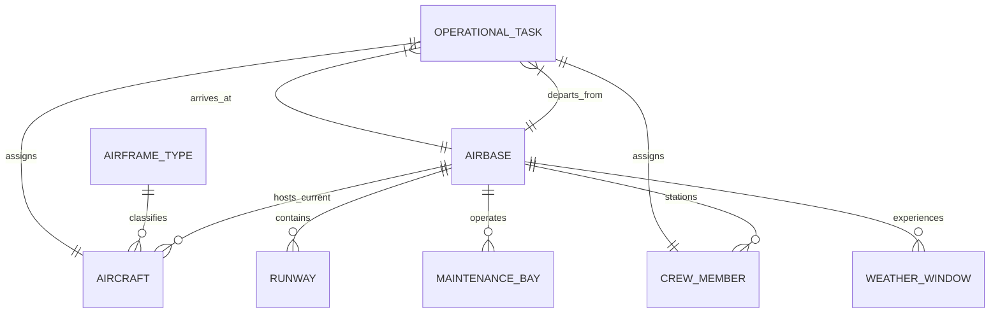

# AIRWISE Canonical Domain Model & Data Contracts

**Project:** AIRWISE — AI-Enabled Dynamic Air Operations & Resource Optimisation  
**SIH Problem Statement:** SIH 26250  
**Document Status:** Complete & Frozen for Implementation  
**Primary Owner:** Nakshatra Yadav (Data Foundation Lead)  
**Co-Reviewers:** Lakshay Bharti (Optimisation & ML Lead), Nidhi Jha (Validation Lead)  

---

## 1. Domain Modeling Philosophy & Standards

To ensure zero ambiguity across workstreams, all domain entities in AIRWISE adhere to strict conventions:
1. **Strong Typing:** Defined using Pydantic v2 `BaseModel` with explicit field validation, frozen constraints where immutable, and JSON Schema exportability.
2. **Explicit Units:** Every numerical field specifies its unit in its name or docstring (e.g. `_minutes`, `_meters`, `_kg`, `_kmh`).
3. **Timestamp Normalization:** Timestamps are normalized to **integer minutes elapsed from simulation epoch ($T_0 = 0$)** for ultra-fast arithmetic in solvers, with ISO 8601 UTC representations for API/UI exchange.
4. **Referential Integrity:** Entity references use typed foreign key identifiers (e.g., `aircraft_id: AircraftId = str`). Dangling references trigger immediate validation failure.



---

## 2. Core Entity Specifications

### 2.1 `Airbase`
Represents a physical operating station with logistics, runways, and maintenance infrastructure.
```python
class Airbase(BaseModel):
    airbase_id: str = Field(..., pattern=r"^BASE-[A-Z0-9]{3,6}$")
    name: str = Field(..., min_length=2, max_length=100)
    latitude: float = Field(..., ge=-90.0, le=90.0)
    longitude: float = Field(..., ge=-180.0, le=180.0)
    elevation_meters: float = Field(default=0.0, ge=-500.0, le=9000.0)
    fuel_capacity_liters: float = Field(default=500000.0, ge=0.0)
    fuel_current_liters: float = Field(default=350000.0, ge=0.0)
    runways: list[str] = Field(default_factory=list)  # Runway IDs
    maintenance_bays: list[str] = Field(default_factory=list)  # Bay IDs
```

### 2.2 `Runway`
A specific takeoff/landing strip with hourly throughput limits.
```python
class Runway(BaseModel):
    runway_id: str = Field(..., pattern=r"^RWY-[A-Z0-9]{3,6}-[0-9]{2}[LCR]?$")
    airbase_id: str
    length_meters: float = Field(..., ge=800.0, le=5000.0)
    width_meters: float = Field(default=45.0, ge=20.0, le=100.0)
    max_hourly_movements: int = Field(default=20, ge=1, le=120)
    is_operational: bool = True
```

### 2.3 `AirframeType`
Specification of an aircraft category defining capabilities, payload, and speed.
```python
class CapabilityClass(str, Enum):
    HEAVY_CARGO = "HEAVY_CARGO"
    TACTICAL_TRANSPORT = "TACTICAL_TRANSPORT"
    FAST_INTERCEPT = "FAST_INTERCEPT"
    HIGH_ALT_RECON = "HIGH_ALT_RECON"
    MARITIME_PATROL = "MARITIME_PATROL"
    SEARCH_AND_RESCUE = "SEARCH_AND_RESCUE"

class AirframeType(BaseModel):
    type_id: str = Field(..., pattern=r"^TYPE-[A-Z0-9_-]{3,20}$")
    name: str
    capability_class: CapabilityClass
    cruise_speed_kmh: float = Field(..., gt=0.0)
    max_range_km: float = Field(..., gt=0.0)
    payload_capacity_kg: float = Field(..., ge=0.0)
    fuel_burn_rate_kg_hr: float = Field(..., gt=0.0)
    nominal_turnaround_minutes: int = Field(default=60, ge=15)
```

### 2.4 `Aircraft`
An individual tail/airframe tracking accumulated fatigue and location.
```python
class MaintenanceStatus(str, Enum):
    OPERATIONAL = "OPERATIONAL"
    SCHEDULED_MAINTENANCE = "SCHEDULED_MAINTENANCE"
    UNSCHEDULED_GROUNDED = "UNSCHEDULED_GROUNDED"
    INSPECTION_DUE = "INSPECTION_DUE"

class Aircraft(BaseModel):
    aircraft_id: str = Field(..., pattern=r"^AC-[0-9]{3,5}$")
    type_id: str
    home_base_id: str
    current_base_id: str
    flight_hours_total: float = Field(default=0.0, ge=0.0)
    flight_hours_since_check: float = Field(default=0.0, ge=0.0)
    flight_cycles_total: int = Field(default=0, ge=0)
    max_hours_between_checks: float = Field(default=500.0, gt=0.0)
    maintenance_status: MaintenanceStatus = MaintenanceStatus.OPERATIONAL
    active_assignment_id: Optional[str] = None
```

### 2.5 `CrewMember`
A certified pilot or mission specialist with duty-hour tracking.
```python
class CrewMember(BaseModel):
    crew_id: str = Field(..., pattern=r"^CREW-[0-9]{3,5}$")
    full_name: str
    certified_classes: list[CapabilityClass] = Field(..., min_length=1)
    home_base_id: str
    current_base_id: str
    cumulative_duty_minutes_24h: int = Field(default=0, ge=0)
    last_duty_end_minute: int = Field(default=-720)  # minutes from epoch
    max_duty_minutes_24h: int = Field(default=480)  # 8 hours
    min_rest_minutes: int = Field(default=720)  # 12 hours
    is_available: bool = True
```

### 2.6 `OperationalTask`
A scheduled mission sortie requiring airframe and crew allocation.
```python
class TaskPriority(int, Enum):
    ROUTINE = 10
    STANDARD = 50
    ELEVATED = 100
    CRITICAL = 500
    VITAL = 1000

class OperationalTask(BaseModel):
    task_id: str = Field(..., pattern=r"^TASK-[0-9]{4,6}$")
    name: str
    priority: TaskPriority = TaskPriority.STANDARD
    origin_base_id: str
    dest_base_id: str
    required_capability: CapabilityClass
    earliest_start_minute: int = Field(..., ge=0)
    latest_start_minute: int = Field(..., ge=0)
    duration_minutes: int = Field(..., gt=0)
    payload_required_kg: float = Field(default=0.0, ge=0.0)

    @model_validator(mode="after")
    def validate_time_window(self) -> Self:
        if self.latest_start_minute < self.earliest_start_minute:
            raise ValueError("latest_start_minute cannot be earlier than earliest_start_minute")
        return self
```

### 2.7 `WeatherWindow`
A localized environmental corridor impacting airbase flight operations.
```python
class WeatherSeverity(int, Enum):
    CLEAR = 0
    MARGINAL = 1
    SEVERE_STORMS = 2
    BELOW_MINIMUMS = 3

class WeatherWindow(BaseModel):
    window_id: str
    airbase_id: str
    start_minute: int = Field(..., ge=0)
    end_minute: int = Field(..., ge=0)
    severity: WeatherSeverity = WeatherSeverity.CLEAR
    runway_movement_multiplier: float = Field(default=1.0, ge=0.0, le=1.0)
```

---

## 3. Structured Operational Event Catalog

State transitions are modeled as explicit, immutable event records:

```python
class EventType(str, Enum):
    AIRCRAFT_GROUNDED = "AIRCRAFT_GROUNDED"
    AIRCRAFT_RELEASED = "AIRCRAFT_RELEASED"
    RUNWAY_CLOSED = "RUNWAY_CLOSED"
    WEATHER_ALERT = "WEATHER_ALERT"
    TASK_DELAYED = "TASK_DELAYED"
    SORTIE_COMPLETED = "SORTIE_COMPLETED"

class OperationalEvent(BaseModel):
    event_id: str = Field(..., pattern=r"^EVT-[A-Z0-9]{8}$")
    timestamp_minute: int = Field(..., ge=0)
    event_type: EventType
    source: str = Field(..., description="Telemetry, Manual, Sensor, WeatherRadar")
    payload: dict[str, Any]
```

### Event Ingestion Semantics
- **Replay Order:** Events are sorted and applied strictly by `timestamp_minute` ascending.
- **Idempotency:** Applying an event with an already processed `event_id` is a no-op.
- **Conflict Resolution:** If two events affect the same entity at the identical timestamp, manual operator updates take precedence over automated sensor telemetry.
