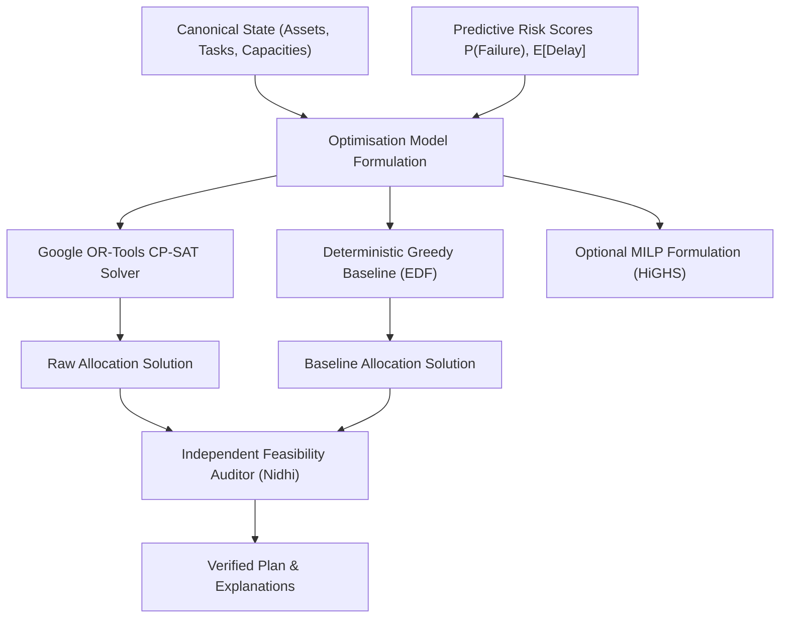

# AIRWISE Mathematical Optimisation & Solver Design

**Project:** AIRWISE — AI-Enabled Dynamic Air Operations & Resource Optimisation  
**SIH Problem Statement:** SIH 26250  
**Document Status:** Complete & Frozen for Implementation  
**Primary Owner:** Lakshay Bharti (Optimisation & Machine Learning Lead)  
**Co-Reviewers:** Nidhi Jha (Independent Evaluation Lead), Nakshatra Yadav (Data Foundation Lead)  

---

## 1. Problem Statement & Mathematical Formulation

The core operational problem in AIRWISE is the **Dynamic Multi-Resource Fleet Scheduling and Assignment Problem under Disruption (DMR-FSAP)**. 

Given an operational planning horizon $[0, T_{\text{horizon}}]$, a set of operational tasks $\mathcal{T}$, a fleet of heterogeneous aircraft $\mathcal{A}$, a roster of qualified crew members $\mathcal{C}$, a network of airbases $\mathcal{B}$ with runways $\mathcal{R}$ and maintenance bays $\mathcal{M}$, find a feasible assignment and timeline that maximizes task fulfillment utility while minimizing delays, operational friction, and disruption risks.



---

## 2. Formal Mathematical Notation

### Sets and Indices
- $t \in \mathcal{T} = \{1, 2, \dots, N_{\text{tasks}}\}$: Operational tasks (e.g. transport, surveillance patrol, humanitarian supply, ferry flight).
- $a \in \mathcal{A} = \{1, 2, \dots, N_{\text{aircraft}}\}$: Aircraft fleet units.
- $c \in \mathcal{C} = \{1, 2, \dots, N_{\text{crew}}\}$: Flight crew personnel.
- $b \in \mathcal{B}$: Airbases.
- $r \in \mathcal{R}_b$: Runways at airbase $b$.
- $m \in \mathcal{M}_b$: Maintenance bays at airbase $b$.
- $k \in \mathcal{K}$: Airframe qualification / capability classes (e.g. `HEAVY_CARGO`, `HIGH_ALT_RECON`, `FAST_INTERCEPT`).

### Parameters
- $p_t \in \mathbb{Z}^+$: Priority weight of task $t$ (e.g., $10$ to $1000$).
- $EST_t, LST_t \in \mathbb{Z}^+$: Earliest start time and Latest acceptable start time (minutes from epoch).
- $D_t \in \mathbb{Z}^+$: Nominal duration of task $t$ (minutes).
- $origin_t, dest_t \in \mathcal{B}$: Origin and destination airbase for task $t$.
- $req\_type_t \in \mathcal{K}$: Required airframe capability class for task $t$.
- $req\_qual_t$: Required crew qualification for task $t$.
- $cap_a \in \mathcal{K}$: Capability class of aircraft $a$.
- $qual_c$: Certification held by crew member $c$.
- $Turnaround_a \in \mathbb{Z}^+$: Mandatory ground turnaround, refueling, and pre-flight inspection time for aircraft $a$ (minutes).
- $MaxDuty_c \in \mathbb{Z}^+$: Maximum allowable continuous flight duty minutes for crew $c$ before mandatory rest.
- $MinRest_c \in \mathbb{Z}^+$: Minimum mandatory crew rest between flight duties (e.g. 720 minutes / 12 hours).
- $MaxSlots_{b, h} \in \mathbb{Z}^+$: Maximum hourly runway takeoff/landing movements at base $b$ during hour $h$.
- $\widehat{P}^{\text{fail}}_a \in [0.0, 1.0]$: Predicted probability that aircraft $a$ will experience unscheduled failure.
- $\widehat{\Delta}_t \in \mathbb{R}^+$: Predicted operational turnaround delay for task $t$ (minutes).

### Decision Variables
- $u_t \in \{0, 1\}$: Binary variable; $1$ if task $t$ is scheduled/fulfilled, $0$ if rejected/unfulfilled.
- $x_{t, a} \in \{0, 1\}$: Binary variable; $1$ if task $t$ is assigned to aircraft $a$, $0$ otherwise.
- $y_{t, c} \in \{0, 1\}$: Binary variable; $1$ if task $t$ is assigned to crew member $c$, $0$ otherwise.
- $s_t \in [EST_t, LST_t]$: Integer variable; scheduled start time of task $t$ (minutes).
- $e_t \in [EST_t + D_t, LST_t + D_t + \widehat{\Delta}_t]$: Integer variable; scheduled end time of task $t$.
- $delay_t \ge 0$: Integer variable; delay beyond earliest preferred start: $delay_t = \max(0, s_t - EST_t)$.

---

## 3. Hard Constraints (Inviolable Feasibility Conditions)

Every feasible schedule must satisfy all of the following constraints simultaneously:

### 1. Task Fulfillment and Unique Assignment
A fulfilled task must be assigned to exactly one compatible aircraft and one certified crew member:
$$\sum_{a \in \mathcal{A}} x_{t, a} = u_t \quad \forall t \in \mathcal{T}$$
$$\sum_{c \in \mathcal{C}} y_{t, c} = u_t \quad \forall t \in \mathcal{T}$$

### 2. Aircraft Capability Compatibility
An aircraft cannot be assigned to a task unless it possesses the required capability class:
$$x_{t, a} = 0 \quad \forall t \in \mathcal{T}, \forall a \in \mathcal{A} \text{ where } cap_a \neq req\_type_t$$

### 3. Crew Qualification Matching
A crew member cannot be assigned to a task unless qualified for that task's aircraft type and mission profile:
$$y_{t, c} = 0 \quad \forall t \in \mathcal{T}, \forall c \in \mathcal{C} \text{ where } req\_qual_t \notin qual_c$$

### 4. Non-Overlapping Aircraft Sorties (Interval Disjunction)
If aircraft $a$ is assigned to both task $t_1$ and task $t_2$ ($t_1 \neq t_2$), their operational windows including ground turnaround and transit buffer must not overlap:
$$\text{NoOverlap}\left( [s_{t_1}, e_{t_1} + Turnaround_a] \cdot x_{t_1, a}, [s_{t_2}, e_{t_2} + Turnaround_a] \cdot x_{t_2, a} \right) \quad \forall a \in \mathcal{A}$$

In CP-SAT, this is formulated directly using optional interval variables:
```python
interval_t_a = model.NewOptionalIntervalVar(
    start=s_t,
    size=duration_with_turnaround,
    end=e_t_with_turnaround,
    is_present=x_t_a,
    name=f"interval_a_{a}_t_{t}",
)
model.AddNoOverlap(all_intervals_for_aircraft[a])
```

### 5. Crew Maximum Flight Duty and Rest Hours
For every crew member $c$, the total flight minutes within any rolling 24-hour window $[W, W + 1440]$ must not exceed $MaxDuty_c$:
$$\sum_{t \in \mathcal{T} : s_t \in [W, W + 1440]} D_t \cdot y_{t, c} \le MaxDuty_c \quad \forall c \in \mathcal{C}$$
Furthermore, consecutive flight assignments $t_1, t_2$ for crew $c$ must be separated by mandatory rest:
$$s_{t_2} \ge e_{t_1} + MinRest_c - M(2 - y_{t_1, c} - y_{t_2, c}) \quad \forall t_1 \neq t_2$$

### 6. Runway Slot Movement Limits
The total number of takeoffs and landings at airbase $b$ in hourly bucket $h = [60h, 60(h+1))$ cannot exceed $MaxSlots_{b, h}$:
$$\sum_{t \in \mathcal{T} : origin_t = b, s_t \in [60h, 60(h+1))} u_t + \sum_{t \in \mathcal{T} : dest_t = b, e_t \in [60h, 60(h+1))} u_t \le MaxSlots_{b, h}$$

### 7. Maintenance Bay Capacity & Inspection Lockout
Aircraft undergoing scheduled maintenance in bay $m \in \mathcal{M}_b$ cannot be assigned to flight tasks during their maintenance interval:
$$x_{t, a} = 0 \quad \forall t \in \mathcal{T} \text{ where } [s_t, e_t] \cap [MaintStart_a, MaintEnd_a] \neq \emptyset$$

---

## 4. Multi-Objective Function & Integer Scaling

The objective function maximizes weighted task fulfillment while penalizing delays, predictive failure risks, crew fatigue, and plan churn.

### Continuous Mathematical Objective
$$\max \quad \mathcal{J} = \sum_{t \in \mathcal{T}} w_t^{\text{priority}} \cdot u_t - \lambda_{\text{delay}} \sum_{t \in \mathcal{T}} delay_t - \lambda_{\text{risk}} \sum_{t \in \mathcal{T}} \sum_{a \in \mathcal{A}} \widehat{P}^{\text{fail}}_a \cdot x_{t, a} - \lambda_{\text{churn}} \sum_{t \in \mathcal{T}} \sum_{a \in \mathcal{A}} |x_{t, a} - x^{\text{baseline}}_{t, a}|$$

Where:
- $w_t^{\text{priority}} = 1000 \cdot p_t$
- $\lambda_{\text{delay}} = 10$ (penalty per minute of departure delay)
- $\lambda_{\text{risk}} = 500$ (penalty scaling for assigning high-failure-risk airframes to sorties)
- $\lambda_{\text{churn}} = 250$ (penalty per reassignment during what-if replanning)

### CP-SAT Integer Scaling Policy
Google OR-Tools CP-SAT requires all objective coefficients and variables to be **integers**. Floating-point probabilities $\widehat{P}^{\text{fail}}_a \in [0.0, 1.0]$ are scaled by factor $K_{\text{scale}} = 10,000$:

$$\text{ScaledRisk}_{t, a} = \left\lfloor 10,000 \cdot \widehat{P}^{\text{fail}}_a \right\rfloor \in [0, 10,000]$$

Scaled CP-SAT Objective:
$$\max \quad \mathcal{J}_{\text{CP-SAT}} = \sum_{t \in \mathcal{T}} 1000 \cdot p_t \cdot u_t - 10 \sum_{t \in \mathcal{T}} delay_t - \sum_{t \in \mathcal{T}} \sum_{a \in \mathcal{A}} \left\lfloor \frac{500 \cdot \text{ScaledRisk}_{t, a}}{10,000} \right\rfloor \cdot x_{t, a} - 250 \sum_{t, a} ChurnVar_{t, a}$$

Coefficient bounds are verified to prevent 64-bit integer overflow: maximum objective magnitude for 1,000 tasks is $< 10^9 \ll 2^{63}-1$.

---

## 5. Solver Interface Architecture & Implementation Contracts

To prevent solver implementation details from leaking into business logic, all optimizers implement the unified `SolverInterface`:

```python
class SolverStatus(str, Enum):
    OPTIMAL = "OPTIMAL"
    FEASIBLE = "FEASIBLE"
    INFEASIBLE = "INFEASIBLE"
    MODEL_INVALID = "MODEL_INVALID"
    UNKNOWN = "UNKNOWN"

class SolverInterface(ABC):
    @abstractmethod
    def solve(
        self,
        state: CanonicalOperationalState,
        config: SolverConfig,
    ) -> OptimizationResult:
        """Solve the resource allocation problem.

        Args:
            state: Snapshot of current canonical operational state.
            config: Solver runtime limits, objective weights, and seed parameters.

        Returns:
            OptimizationResult containing schedule assignments, metrics, status,
            and binding constraint diagnostics.
        """
        pass
```

### Supported Solver Implementations:
1. `CPSatOptimizationSolver` (`src/optimization/cp_sat_solver.py` — Lakshay Bharti): Primary constraint programming solver using Google OR-Tools.
2. `GreedyBaselineSolver` (`src/baselines/greedy_solver.py` — Nidhi Jha): Earliest-Deadline-First greedy allocator sorting tasks by priority and deadline.
3. `MILPOptimizationSolver` (`src/optimization/milp_solver.py` — Lakshay Bharti, Optional): Linearized big-M formulation using SciPy / HiGHS for formal algorithmic comparison.

---

## 6. Solver Configuration & Runtime Limits

```python
@dataclass
class SolverConfig:
    solver_type: str = "OR_TOOLS_CP_SAT"  # or "GREEDY_BASELINE", "MILP_HIGHS"
    time_limit_seconds: float = 30.0
    num_search_workers: int = 8
    log_search_progress: bool = False
    random_seed: int = 42
    weight_priority: int = 1000
    weight_delay_minute: int = 10
    weight_risk: int = 500
    weight_churn: int = 250
```

- **Time-Out Handling:** When `time_limit_seconds` expires, CP-SAT safely returns the best `FEASIBLE` primal solution found with its audited optimality gap. If no feasible solution was discovered, it returns `UNKNOWN` with diagnostic telemetry.
- **Infeasibility Diagnosis:** If `INFEASIBLE` is returned, the solver runs a QuickXplain or Hierarchical Relaxation routine:
  1. Relaxes runway capacity: checks feasibility.
  2. Relaxes crew duty limits: checks feasibility.
  3. Relaxes latest start times: checks feasibility.
  4. Generates a machine-readable explanation of the minimal unsat core (e.g. `"INFEASIBLE_CREW_SHORTAGE: Insufficient qualified pilots for HEAVY_CARGO between 08:00 and 12:00"`).

---

## 7. Baseline Greedy Algorithm Specification (Nidhi Jha)

The `GreedyBaselineSolver` provides an honest, non-vacuous benchmark:
1. **Sort Tasks:** Order tasks in descending order of priority $p_t$, breaking ties by Earliest Start Time ($EST_t$).
2. **Iterative Assignment:** For each task $t$:
   - Find all candidate aircraft $a$ that have capability $cap_a = req\_type_t$ and are idle throughout $[EST_t, EST_t + D_t + Turnaround_a]$.
   - Find all candidate crew $c$ certified for $t$ who have duty hours remaining.
   - If both an aircraft and crew are available:
     - Assign earliest possible start $s_t \in [EST_t, LST_t]$.
     - Lock aircraft and crew interval; mark $u_t = 1$.
   - If no feasible pair exists, mark $u_t = 0$ (unassigned).
3. **Complexity:** $\mathcal{O}(|\mathcal{T}| \cdot |\mathcal{A}| \cdot |\mathcal{C}|)$; runs in $< 50$ms for 200 tasks.

---

## 8. Independent Feasibility Auditor Specification (Nidhi Jha)

The `FeasibilityAuditor` in `src/evaluation/auditor.py` executes strict independent mathematical audits on any returned `OptimizationResult`:
- Audits zero overlapping aircraft intervals without relying on solver variables.
- Audits zero crew duty-hour violations.
- Audits 100% capability and qualification match.
- Recalculates objective score from scratch and compares against solver-reported objective.
- Flags any discrepancy as a critical test failure.
