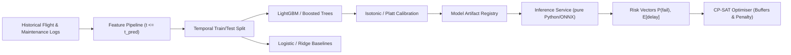

# AIRWISE Predictive Analytics & Forecasting Design

**Project:** AIRWISE — AI-Enabled Dynamic Air Operations & Resource Optimisation  
**SIH Problem Statement:** SIH 26250  
**Document Status:** Complete & Frozen for Implementation  
**Primary Owner:** Lakshay Bharti (Optimisation & Machine Learning Lead)  
**Co-Reviewers:** Nakshatra Yadav (Data Foundation Lead), Nidhi Jha (Validation Lead)  

---

## 1. Objective & Decision Relevance

Predictive models in AIRWISE estimate future operational risks to inform scheduling decisions. Machine learning is **never** used as a solver substitute; it serves exclusively to provide calibrated inputs to the constraint optimization engine.



---

## 2. Decision-Relevant Prediction Targets

### Target 1: Unscheduled Maintenance Degradation Probability ($\widehat{P}^{\text{fail}}_{a, t, H}$)
* **Mathematical Definition:**
  $$\widehat{P}^{\text{fail}}_{a, t, H} = P\left(\text{Aircraft } a \text{ requires unscheduled maintenance in } [t, t + H] \mid \mathcal{F}_t\right)$$
  Where $\mathcal{F}_t$ is the operational information available up to timestamp $t$, and $H$ is the decision horizon (typically $H = 24$ hours).
* **Target Label Construction:** Binary flag $y^{\text{fail}}_{a, t} \in \{0, 1\}$. Evaluated as $1$ if an unscheduled maintenance abort or critical component fault event occurs for aircraft $a$ within $H$ hours after timestamp $t$.
* **Decision Impact in Optimisation:** Directly penalizes assigning airframes with $\widehat{P}^{\text{fail}} > \tau_{\text{risk}}$ to high-priority operational sorties, shifting mission-critical tasks to healthier airframes and routing degrading aircraft to base hangars.

### Target 2: Ground Turnaround Delay Minutes ($\widehat{\Delta}_{t}$)
* **Mathematical Definition:**
  $$\widehat{\Delta}_{t} = \mathbb{E}\left[\text{ActualTurnaround}(t) - \text{NominalTurnaround}(t) \mid \mathcal{F}_t\right]$$
* **Target Label Construction:** Continuous non-negative integer $\Delta_t \ge 0$ representing additional turnaround minutes caused by apron congestion, fueling delays, or minor pre-flight maintenance snags.
* **Decision Impact in Optimisation:** Injects dynamic safety buffers into interval variable durations ($s_{t2} \ge e_{t1} + Turnaround_a + \widehat{\Delta}_{t1}$), preventing cascaded flight delays before they propagate across the network.

---

## 3. Feature Engineering Pipeline & Leakage Prevention

### Feature Catalog

| Feature Group | Feature Name | Description | Data Type | Source Module |
| :--- | :--- | :--- | :--- | :--- |
| **Asset Utilization** | `cum_flight_hours_since_maint` | Total flight hours logged since last A/C check. | Float ($\ge 0$) | Canonical State |
| **Asset Utilization** | `cum_cycles_since_maint` | Total flight cycles (takeoffs) since last check. | Integer ($\ge 0$) | Canonical State |
| **Asset Utilization** | `flight_hours_last_7d` | Intensity metric: flight hours logged in past 168h. | Float ($\ge 0$) | Event History |
| **Asset Health** | `airframe_age_months` | Time elapsed since manufacture/commissioning. | Integer | Static Asset DB |
| **Asset Health** | `engine_vibration_index` | Synthetic telemetry rolling average (0.0 to 1.0). | Float ($[0, 1]$) | Telemetry Stream |
| **Environmental** | `origin_weather_severity` | Weather code (0: Clear, 1: Rain, 2: Storm, 3: Fog).| Categorical | Weather Feed |
| **Environmental** | `ambient_temp_celsius` | Ambient temperature at departure airbase. | Float | Weather Feed |
| **Base Congestion** | `scheduled_movements_window` | Number of takeoffs/landings in $\pm 2$h window. | Integer ($\ge 0$) | Canonical State |
| **Operational** | `mission_profile_type` | Sortie category (Cargo, Recon, Patrol, Ferry). | Categorical | Task Spec |

### Strict Temporal Leakage Prevention
1. **Timestamp Guard ($t_{\text{feature}} \le t_{\text{prediction}}$):** Features are extracted strictly using events whose recorded timestamp is prior to the prediction cut-off time $t_{\text{prediction}}$.
2. **Rolling Window Temporal Splits:** Data is partitioned chronologically (e.g. Weeks 1–3 for Training, Week 4 for Validation, Week 5 for Out-of-Time Testing). Random $k$-fold cross-validation is strictly forbidden for time-series features to avoid lookahead leakage.
3. **Automated Leakage Audit Test:** Unit test `tests/unit/test_leakage_guard.py` asserts that no feature value changes when future synthetic events are appended to the scenario log.

---

## 4. Model Architectures & Calibration

### Candidate Model Hierarchy
1. **Statistical Baselines:**
   - Classification: Empirical class prior $P(y=1)$ and Logistic Regression with $L_2$ regularization.
   - Regression: Historical median turnaround delay and Ridge Regression.
2. **Primary Tabular Models:**
   - LightGBM / scikit-learn `HistGradientBoostingClassifier` and `HistGradientBoostingRegressor`.
   - Tuned hyperparameters: `max_depth=5`, `learning_rate=0.05`, `num_leaves=31`, `min_child_samples=20`.
3. **Model Selection Threshold:** LightGBM must beat the linear baseline by $\ge 15\%$ on ROC-AUC (classification) and MAE (regression) to be accepted into the operational pipeline.

### Probability Calibration
Uncalibrated gradient boosted tree probabilities can be over-confident near boundaries.
- **Method:** Isotonic Regression or Platt Scaling (Sigmoidal) applied on held-out validation predictions.
- **Evaluation Metric:** Brier Score:
  $$\text{Brier} = \frac{1}{N} \sum_{i=1}^N (f_i - y_i)^2 \quad (\text{Target: } \le 0.12)$$
- Calibration curves inspected to ensure slope $\in [0.90, 1.10]$.

---

## 5. Pure Python Inference Interface & Model Registry

Trained models are exported to lightweight, pure-Python serializable artifacts (ONNX or JSON/text trees) stored in `models/checkpoints/`:

```python
class PredictiveAnalyticsService:
    def __init__(self, model_registry_dir: Path):
        self.maintenance_model = self._load_model(model_registry_dir / "maintenance_lgbm.json")
        self.delay_model = self._load_model(model_registry_dir / "delay_lgbm.json")

    def predict_disruption_risks(
        self,
        state: CanonicalOperationalState,
        horizon_hours: float = 24.0,
    ) -> DisruptionRiskProfile:
        """Compute asset failure probabilities and task turnaround delay estimates.

        Args:
            state: Current validated operational state.
            horizon_hours: Lookahead window in hours.

        Returns:
            DisruptionRiskProfile containing per-aircraft failure probabilities
            and per-task expected turnaround delays.
        """
        ...
```

- **Latency Budget:** Inference on 100 assets must complete in $< 15$ms on standard CPU.

---

## 6. Prediction-to-Optimisation Value Experiment

To prove that machine learning provides real operational benefit, AIRWISE defines a controlled benchmark experiment in Phase 10:

### Experimental Setup
1. **Test Dataset:** 50 distinct synthetic scenarios containing probabilistic aircraft failure injections and weather disruptions.
2. **Strategy A (Reactive / No-Prediction Baseline):**
   - Solver uses current state alone.
   - Static nominal turnaround times ($Turnaround_a$).
   - Zero failure risk penalties ($\lambda_{\text{risk}} = 0$).
3. **Strategy B (Prediction-Aware Rolling-Horizon):**
   - Solver ingests calibrated $\widehat{P}^{\text{fail}}_a$ and dynamic delay buffers $\widehat{\Delta}_t$.
   - Airframe risk penalty enabled ($\lambda_{\text{risk}} = 500$).
   - Dynamic buffers inserted into turnaround constraints.

### Measurable Evaluation Metrics:
- **Mission Abort Rate (%):** Percentage of launched sorties that suffered in-flight abort due to mechanical failure.
- **Cascaded Delay Minutes:** Sum of delay minutes propagated to subsequent flight legs.
- **Net Operational Utility:** Realized composite score after executing the simulated day.
- **Hypothesis:** Strategy B reduces mission aborts by $\ge 30\%$ and cascaded delays by $\ge 20\%$ with $< 5\%$ degradation in nominal task completion rate.
