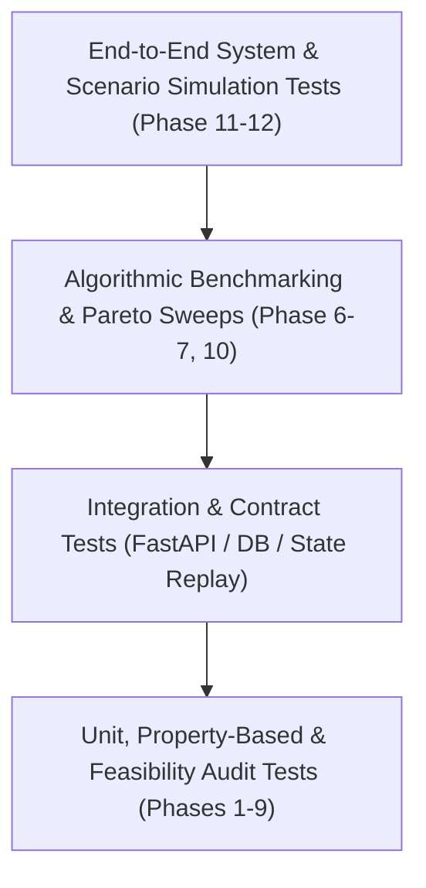

# AIRWISE Comprehensive Testing Strategy & Quality Gates

**Project:** AIRWISE — AI-Enabled Dynamic Air Operations & Resource Optimisation  
**SIH Problem Statement:** SIH 26250  
**Document Status:** Complete & Frozen for Implementation  
**Primary Owner:** Nidhi Jha (Test Architect & Independent Evaluation Lead)  
**Co-Reviewers:** Lakshay Bharti (Optimisation & ML Lead), Nakshatra Yadav (Data Foundation Lead)  

---

## 1. Testing Philosophy & Test Pyramid

AIRWISE enforces continuous verification at every layer of the modular monolith. No task may be marked `VERIFIED COMPLETE` in `COMPLETION.md` without automated, reproducible test evidence.

---

## 2. Testing Specifications by Domain

### 2.1 Data & Ingestion Testing (Nakshatra Yadav)
* **Schema Validation Tests (`tests/unit/test_schemas.py`):**
  - Verify rejection of invalid IDs, out-of-bounds geographic coordinates, negative flight hours, and inverted time windows ($LST < EST$).
* **Generator Determinism Tests (`tests/unit/test_generator_reproducibility.py`):**
  - Assert that two separate generator invocations with `seed=42` produce byte-identical JSON strings.
  - Property test: Ensure 100% referential integrity across 1,000 generated entities (zero dangling keys).
* **Safe Ingestion & Threat Tests (`tests/unit/test_safe_ingestion.py`):**
  - Test archive decompression bomb rejection (archives exceeding 50 MB rejected).
  - Test Zip-Slip path traversal rejection (`../../etc/shadow`).
  - Test NaN/Inf and SQL injection payload neutralization.

### 2.2 Canonical State & Event Replay Testing (Nakshatra Yadav)
* **Deterministic Replay Test (`tests/unit/test_state_replay.py`):**
  - Apply 200 operational events in chronological order: compute state hash $H_1$.
  - Shuffle the same 200 events out-of-order and ingest via the fusion engine: assert final state hash $H_2 == H_1$.
* **Snapshot Immutability Test (`tests/unit/test_state_snapshot.py`):**
  - Take snapshot of state; mutate original state; assert snapshot values remain unaltered.

### 2.3 Optimisation & Constraint Testing (Lakshay Bharti & Nidhi Jha)
* **Independent Feasibility Auditor (`tests/unit/test_feasibility_auditor.py` — Nidhi Jha):**
  - Independent validator that asserts zero interval overlaps, zero qualification mismatches, and zero crew duty violations without touching solver internal variables.
* **Known Feasible & Infeasible Edge Cases (`tests/unit/test_solver_edge_cases.py` — Lakshay Bharti):**
  - Scenario with 5 tasks and 1 aircraft: verify solver correctly delays or leaves unassigned tasks rather than violating overlaps.
  - Scenario with 0 qualified pilots: verify solver returns `INFEASIBLE` or `FEASIBLE` with 0 unfulfilled tasks without crashing.
* **Timeout Enforcement Test:**
  - On a massive 500-task scenario with `time_limit_seconds=5.0`, assert solver terminates cleanly at $5.0 \pm 0.5$s returning the best primal solution found.
* **CP-SAT vs. Greedy Baseline Comparison (`tests/unit/test_solver_comparison.py` — Nidhi Jha):**
  - Run both solvers on 20 identical test scenarios: assert $\mathcal{J}_{\text{CP-SAT}} \ge \mathcal{J}_{\text{Greedy}}$ in 100% of cases.

### 2.4 Machine Learning & Calibration Testing (Lakshay Bharti)
* **Temporal Leakage Guard (`tests/unit/test_leakage_guard.py`):**
  - Assert that feature extraction functions for timestamp $T$ inspect only records with $t \le T$.
* **Calibration Verification (`tests/unit/test_model_calibration.py`):**
  - Compute Brier score on test split: assert $\text{Brier} \le 0.15$.
  - Assert calibration curve slope $\in [0.85, 1.15]$.
* **Inference Latency & Pure-Python Loading (`tests/unit/test_model_inference.py`):**
  - Assert batch inference on 100 aircraft runs in $< 20$ms on CPU without training dependencies.

### 2.5 Simulation, What-If & Diff Testing (Nidhi Jha)
* **Counterfactual Sandbox Isolation (`tests/unit/test_sandbox_isolation.py`):**
  - Clone baseline scenario; inject `AircraftGroundedEvent`; re-optimize; assert baseline state remains bit-unmodified.
* **Plan Diff Veracity (`tests/unit/test_diff_analyzer.py`):**
  - Assert that reassigning task $T_1$ from aircraft $A_1$ to $A_2$ produces exactly 1 reassignment entry in the diff JSON.

### 2.6 REST API & Contract Testing (All Workstreams)
* **FastAPI Endpoint Tests (`tests/integration/test_api.py`):**
  - Test `/api/v1/scenarios`, `/api/v1/optimize`, `/api/v1/simulation/what-if` with `httpx`.
  - Assert valid HTTP status codes (`200 OK`, `400 Bad Request`, `422 Unprocessable Entity`).
* **Frontend Handoff Contract Tests (`tests/integration/test_frontend_contracts.py`):**
  - Validate that backend responses strictly conform to frontend TypeScript schema specifications (`frontend/src/api/types.ts`).

---

## 3. Phase Quality Gates & Verification Checklist

Before any phase can be signed off as `VERIFIED COMPLETE` in `COMPLETION.md`, it must pass its designated Quality Gate:

| Phase | Quality Gate Title | Required Verification Evidence | Owning Lead |
| :--- | :--- | :--- | :--- |
| **Phase 0** | Architecture & Foundations | Documentation complete, Git clean, zero circular references. | All |
| **Phase 1** | Dataset Audit & Decision | Evidence-backed audit in `docs/data-audit.md`, download tests passed. | Nakshatra |
| **Phase 2** | Mathematical Formulation | Optimization and prediction equations reviewed, bounds validated. | Lakshay |
| **Phase 3** | Domain Models & Schemas | 100% unit test pass on Pydantic schemas, invariant assertions. | Nakshatra |
| **Phase 4** | Synthetic Generator | Deterministic seed test passing, 100% referential integrity verified. | Nakshatra |
| **Phase 5** | Canonical State & Replay | Out-of-order event replay hash equivalence verified. | Nakshatra |
| **Phase 6** | Baselines & Auditor | Independent auditor passes on synthetic tests, Greedy solver verified. | Nidhi |
| **Phase 7** | CP-SAT Optimiser | CP-SAT beats Greedy on 20 instances, 0 hard constraint violations. | Lakshay |
| **Phase 8** | ML Pipeline & Target Design | Temporal train/test split verified, 0 data leakage confirmed. | Lakshay |
| **Phase 9** | Predictive Benchmarking | Boosted tree beats linear baseline by $\ge 15\%$, calibrated probabilities. | Lakshay |
| **Phase 10** | Prediction-Aware Optimisation | Proved downstream benefit (reduced aborts) vs current-state baseline. | Lakshay & Nidhi |
| **Phase 11** | Simulation & What-If Engine | Sandbox isolation confirmed, diff analyzer outputs verified. | Nidhi |
| **Phase 12** | Core API & Frontend Handoff | Full test suite passing ($\ge 85\%$ coverage), typed API contracts ready. | All |
