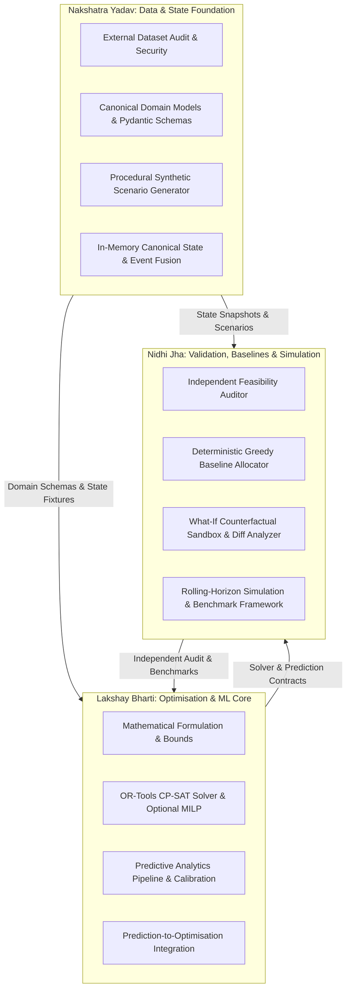
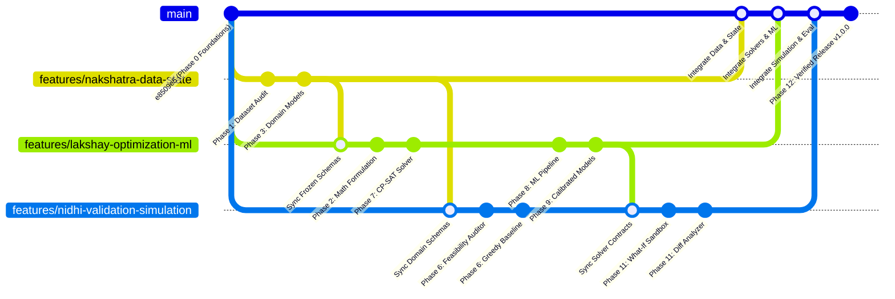

# AIRWISE Three-Person Workstream Partitioning & Ownership Specification

**Project:** AIRWISE — AI-Enabled Dynamic Air Operations & Resource Optimisation  
**SIH Problem Statement:** SIH 26250  
**Document Status:** Complete, Balanced & Frozen for Implementation  
**Authors:** Lakshay Bharti, Nakshatra Yadav, Nidhi Jha  

---

## 1. Principles of Workload Partitioning

To ensure that three separate coding agents can develop in parallel with minimal merge conflicts and clean modular interfaces, the core engineering workload is partitioned according to four strict architectural principles:

1. **Mutual Exclusivity:** Every file, module, and implementation task has **exactly one primary owner**. No source module has two default owners.
2. **Collective Exhaustiveness:** Every in-scope requirement across all 13 project phases (Phases 0 to 12) is assigned to a primary owner.
3. **Balanced Engineering Effort:** Workload is balanced across algorithmic complexity, software engineering volume, data pipelines, testing, and integration overhead.
4. **Interface-Driven Decoupling:** Shared interfaces (domain models, solver interface, prediction interface) are frozen before parallel feature branch development.
5. **Frontend Scope Boundary:** The React/TypeScript dashboard is developed by separate teammates and is **outside the implementation scope of these three workstreams**. This team delivers typed API contracts and integration endpoints.

---

## 2. Executive Workstream Ownership Summary

| Workstream Lead | Primary Core Responsibility | Primary Owned Directories | Est. Effort (Days) | Est. Story Points |
| :--- | :--- | :--- | :--- | :--- |
| **Lakshay Bharti** | Mathematical Optimisation (CP-SAT/MILP), Predictive Analytics (LightGBM), Prediction-Aware Optimization | `src/optimization/`, `src/prediction/`, `configs/optimization/`, `configs/models/` | **22 Days** | **55 SP** |
| **Nakshatra Yadav**| Dataset Audit & Adapters, Canonical Domain Models, Synthetic Scenario Generator, State Management & Event Fusion | `src/domain/`, `src/data/`, `src/state/`, `data/scenarios/`, `configs/data/` | **21 Days** | **52 SP** |
| **Nidhi Jha** | Independent Feasibility Auditor, Greedy Baseline Allocator, Counterfactual What-If Sandbox, Scientific Benchmarks & Evaluation | `src/baselines/`, `src/evaluation/`, `src/simulation/`, `experiments/` | **21 Days** | **53 SP** |
| **External Team** | React / TypeScript Dashboard, UI Styling, Gantt Timeline Visualization, Chart Components | `frontend/` | N/A (External) | N/A (External) |

---

## 3. Master Task-to-Owner Allocation Matrix (Phases 0 to 12)

| Phase ID & Name | Task ID | Task Description | Primary Owner | Consumed Interface / Dependency | Output Deliverable / Hand-off | Est. Days |
| :--- | :--- | :--- | :--- | :--- | :--- | :--- |
| **Phase 0: Foundations** | `T0-01..14` | Repo inspection, architecture, 13 phases, master planning docs | **All (Lakshay Lead)** | None | Clean `main` branch & documentation suite | 3.0 |
| **Phase 1: Dataset Audit** | `T1-01` | External dataset investigation, licensing, download verification | **Nakshatra** | Research portals | `docs/data-audit.md` | 2.0 |
| **Phase 1: Dataset Audit** | `T1-02` | Threat model, safe ingestion checklist, quarantine rules | **Nakshatra** | `T1-01` | Security assessment in `docs/data-audit.md` | 1.0 |
| **Phase 2: Formal Problem**| `T2-01` | Mathematical problem formulation, decision variables, bounds | **Lakshay** | Problem statement | `docs/optimisation-design.md` | 2.5 |
| **Phase 2: Formal Problem**| `T2-02` | Prediction target formulation and downstream decision mapping | **Lakshay** | `T2-01` | `docs/prediction-design.md` | 1.5 |
| **Phase 3: Domain Models** | `T3-01` | Core Pydantic v2 domain models (`Airbase`, `Aircraft`, `Crew`) | **Nakshatra** | `T2-01` | `src/domain/models.py`, `schemas.py` | 2.0 |
| **Phase 3: Domain Models** | `T3-02` | Units, timestamp conversions, schema validation rules | **Nakshatra** | `T3-01` | `docs/data-model.md`, unit tests | 1.0 |
| **Phase 3: Domain Models** | `T3-03` | Schema review & solver contract alignment | **Lakshay & Nidhi** | `T3-01` | Sign-off on frozen schema interfaces | 0.5 |
| **Phase 4: Synthetic Gen** | `T4-01` | Procedural generator engine with seed-based reproducibility | **Nakshatra** | `T3-01` | `src/generator/scenario_generator.py` | 3.0 |
| **Phase 4: Synthetic Gen** | `T4-02` | Configurable scenario profiles (Nominal, Strained, Extreme) | **Nakshatra** | `T4-01` | `src/generator/profiles.py` | 1.5 |
| **Phase 4: Synthetic Gen** | `T4-03` | Small debugging fixtures (5 tasks) & benchmark suites (200 tasks)| **Nakshatra** | `T4-02` | `data/scenarios/*.json` | 1.0 |
| **Phase 5: State & Fusion** | `T5-01` | Structured event catalog & immutable event schemas | **Nakshatra** | `T3-01` | `src/state/events.py` | 1.5 |
| **Phase 5: State & Fusion** | `T5-02` | In-memory Canonical State container with indexed lookups | **Nakshatra** | `T5-01` | `src/state/canonical_state.py` | 2.0 |
| **Phase 5: State & Fusion** | `T5-03` | Data fusion engine with conflict resolution & replay | **Nakshatra** | `T5-02` | `src/state/fusion_engine.py` | 2.5 |
| **Phase 6: Feasibility & Baseline** | `T6-01` | Independent Feasibility Auditor (inviolate constraints) | **Nidhi** | `T3-01`, `T2-01` | `src/evaluation/auditor.py` | 3.0 |
| **Phase 6: Feasibility & Baseline** | `T6-02` | Deterministic Greedy Baseline Allocator (Earliest Deadline) | **Nidhi** | `T3-01` | `src/baselines/greedy_solver.py` | 2.5 |
| **Phase 6: Feasibility & Baseline** | `T6-03` | Feasibility audit & baseline tests on synthetic fixtures | **Nidhi** | `T6-01`, `T6-02`, `T4-03` | `tests/unit/test_baselines.py` | 1.5 |
| **Phase 7: CP-SAT Optimiser** | `T7-01` | `SolverInterface` contracts and result envelope | **Lakshay** | `T3-01` | `src/optimization/solver_interface.py`| 1.0 |
| **Phase 7: CP-SAT Optimiser** | `T7-02` | CP-SAT formulation: interval disjunctions & cumulative slots | **Lakshay** | `T7-01`, `T2-01` | `src/optimization/cp_sat_solver.py` | 4.0 |
| **Phase 7: CP-SAT Optimiser** | `T7-03` | Integer objective scaling, solver timeouts & status extraction | **Lakshay** | `T7-02` | `src/optimization/objectives.py` | 1.5 |
| **Phase 7: CP-SAT Optimiser** | `T7-04` | Optional MILP comparative solver formulation (HiGHS) | **Lakshay** | `T7-01` | `src/optimization/milp_solver.py` | 2.0 |
| **Phase 7: CP-SAT Optimiser** | `T7-05` | Benchmarking CP-SAT vs. Greedy Baseline on 20 instances | **Nidhi** | `T7-02`, `T6-02` | Audit report in `experiments/` | 1.5 |
| **Phase 8: ML Pipeline** | `T8-01` | Feature extraction pipeline with temporal timestamp cut-offs | **Lakshay** | `T5-02` | `src/prediction/features.py` | 2.5 |
| **Phase 8: ML Pipeline** | `T8-02` | Temporal train/test split and synthetic ground-truth labeling | **Lakshay** | `T8-01`, `T4-01` | `src/prediction/train.py` | 2.0 |
| **Phase 8: ML Pipeline** | `T8-03` | Leakage guard automated unit tests | **Lakshay** | `T8-02` | `tests/unit/test_leakage_guard.py` | 1.0 |
| **Phase 9: Predictive Benchmarking** | `T9-01` | Train and calibrate LightGBM maintenance failure classifier | **Lakshay** | `T8-02` | `src/prediction/models.py` | 2.5 |
| **Phase 9: Predictive Benchmarking** | `T9-02` | Train turnaround delay regression model | **Lakshay** | `T8-02` | `src/prediction/models.py` | 2.0 |
| **Phase 9: Predictive Benchmarking** | `T9-03` | Probability calibration (Platt/Isotonic) & Brier score audit | **Lakshay** | `T9-01` | Calibration report & metrics | 1.5 |
| **Phase 9: Predictive Benchmarking** | `T9-04` | Pure-Python model export & lightweight inference service | **Lakshay** | `T9-01`, `T9-02` | `src/prediction/service.py` | 1.5 |
| **Phase 10: Prediction-Aware Optimisation** | `T10-01` | Connect predicted failure risks and delay buffers to solver | **Lakshay** | `T7-02`, `T9-04` | `src/optimization/risk_aware_solver.py`| 2.5 |
| **Phase 10: Prediction-Aware Optimisation** | `T10-02` | Downstream evaluation: reactive vs prediction-aware experiment | **Nidhi** | `T10-01` | Benchmark report in `experiments/` | 2.5 |
| **Phase 11: Simulation & What-If** | `T11-01` | Isolated `ScenarioSandbox` state cloner (0 mutation on source) | **Nidhi** | `T5-02` | `src/simulation/sandbox.py` | 2.0 |
| **Phase 11: Simulation & What-If** | `T11-02` | Disruption mutation operators (`GroundAircraft`, `CloseRunway`) | **Nidhi** | `T11-01` | `src/simulation/disruptions.py` | 2.0 |
| **Phase 11: Simulation & What-If** | `T11-03` | Rolling-horizon replanning loop and Plan Diff Analyzer | **Nidhi** | `T11-02`, `T10-01` | `src/simulation/diff_analyzer.py` | 2.5 |
| **Phase 11: Simulation & What-If** | `T11-04` | Stress testing, robustness evaluation & failure recovery | **Nidhi** | `T11-03` | `tests/unit/test_what_if_engine.py` | 2.0 |
| **Phase 12: Core API & Handoff** | `T12-01` | FastAPI routes for scenario, state, solver, simulation | **Nakshatra** | All services | `src/api/routes/*.py` | 2.5 |
| **Phase 12: Core API & Handoff** | `T12-02` | Integration testing, full test suite pass ($\ge 85\%$ coverage) | **Nidhi** | `T12-01` | `tests/integration/test_api.py` | 2.0 |
| **Phase 12: Core API & Handoff** | `T12-03` | Frontend handoff: typed JSON schemas, OpenAPI export, docs | **Lakshay** | `T12-01` | `docs/FRONTEND_HANDOFF.md`, OpenAPI spec| 1.5 |

---

## 4. Git Branching Strategy & Integration Workflow

Development proceeds on dedicated, isolated feature branches. The `main` branch remains protected and represents verified, reviewed, and tested releases.

### Branch Rules & Hygiene:
1. **Designated Branches:**
   - `features/lakshay-optimization-ml`
   - `features/nakshatra-data-state`
   - `features/nidhi-validation-simulation`
2. **Commit Conventions:** Follow Conventional Commits format (`feat(optimization): ...`, `test(state): ...`).
3. **Zero Cross-Owner Overwrites:** An agent must not modify files owned by another workstream without explicit agreement.
4. **Interface Synchronization:** Merges between feature branches occur only at documented hand-off points (e.g., syncing frozen schemas from Nakshatra).
5. **No Premature Main Merges:** Nothing is merged into `main` until independent unit and integration tests pass cleanly.

---

## 5. Deferred Per-Person Planning Workflow

To maintain absolute architectural consistency and avoid premature task proliferation:
* **No generic `checklist.md` is placed at the repository root.**
* **Individual phase and checklist documents (`PHASES_LAKSHAY.md`, `CHECKLIST_LAKSHAY.md`, etc.) are DEFERRED until implementation begins.**
* **Mandatory Activation Protocol:** When each coding agent is launched to begin its respective implementation, it must:
  1. Ingest `ARCHITECTURE.md`, `PHASES.md`, `ROADMAP.md`, `REQUIREMENTS.md`, and its dedicated ownership file (`Lakshay.md`, `Nakshatra.md`, or `Nidhi.md`).
  2. Create its local operational phase plan (`PHASES_<NAME>.md`) and living checklist (`CHECKLIST_<NAME>.md`).
  3. Execute tasks strictly within its assigned directory boundaries.
